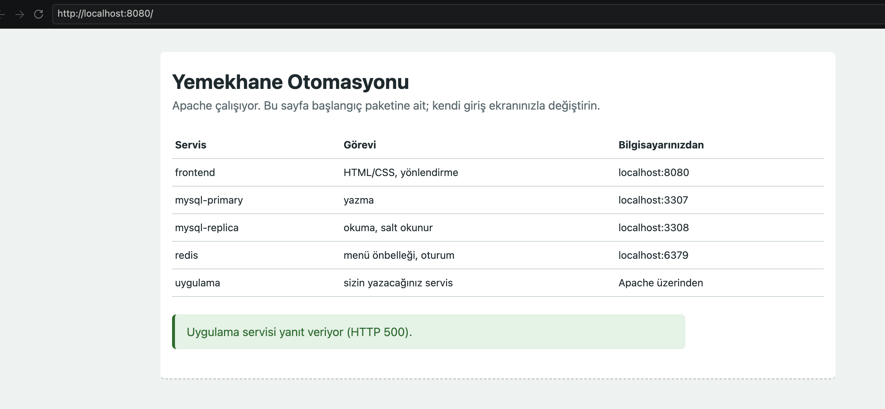
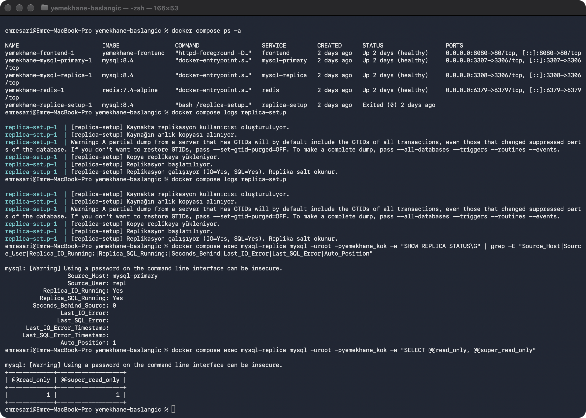
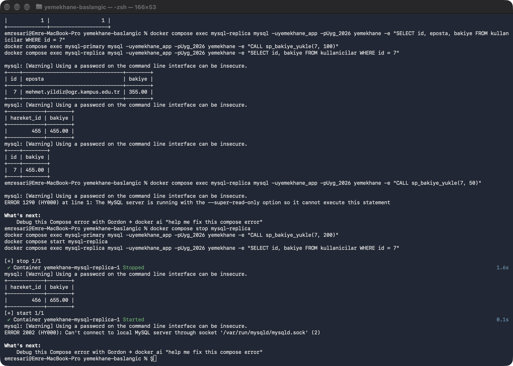

# Aşama 1 · Altyapı

Tarih: 18.11.2026 · Ortam: macOS (Darwin 27.0), Docker 29.8.0, Docker Compose v5.5.1

Başlangıç paketi `docker compose up -d` ile ek bir ayar yapılmadan ayağa kaldırıldı ve README'deki
doğrulama komutları sırayla çalıştırıldı. 

## 1. Servislerin durumu

```
> docker compose ps -a
SERVICE         STATUS                     PORTS
frontend        Up 30 seconds (healthy)    0.0.0.0:8080->80/tcp
mysql-primary   Up 30 seconds (healthy)    0.0.0.0:3307->3306/tcp
mysql-replica   Up 29 seconds (healthy)    0.0.0.0:3308->3306/tcp
redis           Up 29 seconds (healthy)    0.0.0.0:6379->6379/tcp
replica-setup   Exited (0) 3 seconds ago
```

Dört servis `healthy` durumda. `replica-setup` replikayı kurduktan sonra `0` koduyla çıkıyor
```
> docker compose logs replica-setup
[replica-setup] Replikasyon çalışıyor (IO=Yes, SQL=Yes). Replika salt okunur.
```

## 2. Replikasyon durumu

```
> docker compose exec mysql-replica mysql -uroot -pyemekhane_kok -e "SHOW REPLICA STATUS\G"
                  Source_Host: mysql-primary
                  Source_User: repl
           Replica_IO_Running: Yes
          Replica_SQL_Running: Yes
        Seconds_Behind_Source: 0
                Last_IO_Error:
               Last_SQL_Error:
                Auto_Position: 1
```


Replikanın salt okunur ayarları: `@@read_only = 1`, `@@super_read_only = 1`.

## 3. Kaynakta yazma, replikada okuma

```
> docker compose exec mysql-replica mysql -uyemekhane_app -pUyg_2026 yemekhane -e "SELECT id, eposta, bakiye FROM kullanicilar WHERE id = 7"
id  eposta                            bakiye
7   mehmet.yildiz@ogr.kampus.edu.tr   355.00

> docker compose exec mysql-primary mysql -uyemekhane_app -pUyg_2026 yemekhane -e "CALL sp_bakiye_yukle(7, 100)"
hareket_id  bakiye
455         455.00

> docker compose exec mysql-replica mysql -uyemekhane_app -pUyg_2026 yemekhane -e "SELECT id, bakiye FROM kullanicilar WHERE id = 7"
id  bakiye
7   455.00
```

Yükleme kaynakta (`mysql-primary`) yapıldı. Yeni bakiye (355,00 + 100 = 455,00) replikada da görünüyor.

## 4. Replikaya yazma denemesi

```
> docker compose exec mysql-replica mysql -uyemekhane_app -pUyg_2026 yemekhane -e "CALL sp_bakiye_yukle(7, 50)"
ERROR 1290 (HY000) at line 1: The MySQL server is running with the --super-read-only option so it cannot execute this statement
```

Replika yazma işlemini reddediyor

## 5. Replika kapalıyken yapılan değişikliğin yakalanması

```
> docker compose stop mysql-replica
 Container yemekhane-mysql-replica-1 Stopped
mysql-replica   Exited (0)

> docker compose exec mysql-primary mysql -uyemekhane_app -pUyg_2026 yemekhane -e "CALL sp_bakiye_yukle(7, 200)"
hareket_id  bakiye
456         655.00

> docker compose start mysql-replica
mysql-replica   Up 5 seconds (healthy)

> docker compose exec mysql-replica mysql -uyemekhane_app -pUyg_2026 yemekhane -e "SELECT id, bakiye FROM kullanicilar WHERE id = 7"
id  bakiye
7   655.00
```

Replika kapalıyken kaynakta 200 TL yüklendi. Replika yeniden başlatıldığında aradaki işlemi kaynağın
binlog'undan aldı ve bakiye 655,00 olarak göründü. Sonrasında `Replica_IO_Running` ve
`Replica_SQL_Running` yine `Yes`.

## 6. Redis

```
> docker compose exec redis redis-cli ping
PONG
```

## Ekran görüntüleri

Başlangıç sayfası (`localhost:8080`). Uygulama servisi henüz yazılmadığı için "HTTP 500" yazıyor:



1. ve 2. bölümdeki komutlar (servisler, `replica-setup` günlüğü, replikasyon durumu, salt okunur):



3., 4. ve 5. bölümdeki komutlar. En alttaki `ERROR 2002`, son sorgunun replika yeniden başlatıldıktan
hemen sonra, MySQL henüz bağlantı kabul etmeden çalıştırılmasından kaynaklanıyor. Birkaç saniye sonra
tekrarlanan sorgunun sonucu (655,00) 5. bölümde:



## Sonuç

Tüm kontroller README'de beklenen sonuçları verdi. 2. aşamaya geçiliyor 
