# Aşama 2 · Uygulama

Tarih: 19.11.2026 · Ortam: macOS (Darwin 27.0), Docker 29.8.0, Docker Compose v5.5.1, Node.js 22

## Seçilen yol

**Web API + arayüz.** Uygulama yalnızca JSON döner. HTML5 + CSS3 arayüz `frontend/` klasöründe
durur ve veriyi JavaScript `fetch` ile alır. Apache `/api/` ile başlayan istekleri uygulamaya iletir.
Framework olarak **Node.js + Express 5** kullanıldı.

## 1. Uygulama iskeleti

`uygulama/` klasöründe bir Node projesi oluşturuldu ve Express kuruldu:

```
> npm init -y
> npm install express
```

`package.json` içindeki bağımlılık: `"express": "^5.3.0"`. `package-lock.json` bağımlılık
sürümlerini kilitler; Docker imajı aynı sürümleri kurar.

İlk sürüm `uygulama/index.js`, tek bir uç içerir. Uygulama container içinde 8000 portunu dinler:

```js
const express = require('express');

const app = express();
const PORT = 8000;

app.get('/api/saglik', (req, res) => {
  res.json({ durum: 'ok' });
});

app.listen(PORT, () => {
  console.log(`Uygulama ${PORT} portunda dinliyor`);
});
```

Docker'sız yerel denemede tanımlı uç 200, tanımsız uç 404 döndü:

```
> curl -i http://localhost:8000/api/saglik
HTTP/1.1 200 OK
Content-Type: application/json; charset=utf-8

{"durum":"ok"}

> curl -o /dev/null -w "HTTP %{http_code}\n" http://localhost:8000/api/yok
HTTP 404
```

## 2. Dockerfile

`uygulama/Dockerfile`:

```dockerfile
FROM node:22-alpine

WORKDIR /app

# Önce yalnızca bağımlılık dosyaları: kod değişince npm ci yeniden çalışmasın
COPY package.json package-lock.json ./
RUN npm ci --omit=dev

# Sonra uygulama kodu
COPY . .

EXPOSE 8000

# root yerine node kullanıcısıyla çalış
USER node

CMD ["node", "index.js"]
```

- Bağımlılıklar koddan önce kopyalanır; böylece `index.js` değişince Docker `npm ci` katmanını
  önbellekten kullanır.
- `npm ci`, `package-lock.json`'daki sürümleri birebir kurar.
- `.dockerignore` içinde `node_modules` var: macOS'ta kurulmuş paketler Linux imajına girmez
  (`bcrypt` gibi paketler işletim sistemine özgü derlenir).
- Uygulama `root` yerine yetkisiz `node` kullanıcısıyla çalışır. Geçici imajla yapılan denemede
  `docker exec ... whoami` çıktısı `node` oldu.

## 3. Compose'a uygulama servisi

`docker-compose.yml` içindeki hazır `uygulama:` bloğunun yorum işaretleri kaldırıldı:

```yaml
  uygulama:
    build: ./uygulama
    restart: unless-stopped
    environment:
      <<: *uygulama-ortam
    depends_on:
      mysql-primary:
        condition: service_healthy
      redis:
        condition: service_healthy
      replica-setup:
        condition: service_completed_successfully
```

- `environment`, dosyanın başındaki `x-uygulama-ortam` bloğunu (`DB_YAZMA_HOST`, `DB_OKUMA_HOST`,
  `REDIS_HOST` vb.) uygulamaya aktarır.
- `depends_on`, uygulamanın kaynak veritabanı ve Redis sağlıklı olmadan, replika kurulumu da
  başarıyla bitmeden başlamasını engeller.
- `uygulama` servisine `ports:` verilmedi. 8000 portu yalnızca Docker'ın iç ağında açıktır;
  dışarıdan tek giriş Apache'dir (8080).
- Apache modu için `frontend` servisinde `-D WEBAPI` zaten ayarlıydı. `apache/yemekhane.conf`
  içinde bu mod `/api/` isteklerini `http://uygulama:8000/api/` adresine iletir.

```
> docker compose up -d --build
> docker compose ps -a
SERVICE         STATUS                      PORTS
frontend        Up 2 days (healthy)         0.0.0.0:8080->80/tcp, [::]:8080->80/tcp
mysql-primary   Up 2 days (healthy)         0.0.0.0:3307->3306/tcp, [::]:3307->3306/tcp
mysql-replica   Up 51 minutes (healthy)     0.0.0.0:3308->3306/tcp, [::]:3308->3306/tcp
redis           Up 2 days (healthy)         0.0.0.0:6379->6379/tcp, [::]:6379->6379/tcp
replica-setup   Exited (0) 12 minutes ago
uygulama        Up 12 minutes               8000/tcp
```

Mevcut beş container yeniden oluşturulmadı, veritabanı verileri korundu. `replica-setup`
`uygulama`'nın bağımlılığı olduğu için yeniden çalıştı ve "Replika zaten yapılandırılmış, işlem
yapılmadı" çıktısıyla bitti (betik tekrar çalıştırılabilir).

## 4. Apache üzerinden doğrulama

```
> curl -i http://localhost:8080/api/saglik
HTTP/1.1 200 OK
Server: Apache/2.4.71 (Unix)
X-Powered-By: Express
Content-Type: application/json; charset=utf-8

{"durum":"ok"}
```

`Server: Apache` ve `X-Powered-By: Express` başlıklarının birlikte görünmesi, isteğin Apache'den
geçip Express tarafından yanıtlandığını gösterir.

```
> curl -o /dev/null -w "HTTP %{http_code}\n" http://localhost:8080/
HTTP 200
> curl -m 3 http://localhost:8000/api/saglik
(bağlantı kurulamadı)
```

Ana sayfa Apache'nin `frontend/` klasöründen sunulmaya devam ediyor. Uygulamanın 8000 portuna
dışarıdan ulaşılamıyor; istekler yalnızca Apache üzerinden geliyor.

Uygulama günlüğü:

```
> docker compose logs uygulama
uygulama-1  | Uygulama 8000 portunda dinliyor
```

Ekran görüntüsü: tarayıcıda `http://localhost:8080/api/saglik` adresi.


## 5. Veri katmanı: yazma ve okuma havuzları

`mysql2` sürücüsü kuruldu (`npm install mysql2`, sürüm 3.24.6). `uygulama/veri/baglanti.js`
iki bağlantı havuzu tanımlar; bağlantı bilgileri koda yazılmaz, compose'un verdiği ortam
değişkenlerinden okunur:

```js
const mysql = require('mysql2/promise');

const ortak = {
  port: Number(process.env.DB_PORT),
  database: process.env.DB_ADI,
  user: process.env.DB_KULLANICI,
  password: process.env.DB_SIFRE,
  charset: 'utf8mb4',     // Türkçe karakterler (ş, ğ, ı) bozulmasın
  timezone: '+03:00',     // veritabanı sunucusunun saat dilimiyle aynı
  waitForConnections: true,
  connectionLimit: 10,    // havuzda aynı anda en fazla 10 bağlantı
};

// Yazma işlemleri (INSERT, UPDATE, stored procedure) yalnızca buradan: kaynak sunucu
const yazmaHavuzu = mysql.createPool({ ...ortak, host: process.env.DB_YAZMA_HOST });

// Okuma işlemleri (SELECT, listeleme, rapor) buradan: replika sunucu
const okumaHavuzu = mysql.createPool({ ...ortak, host: process.env.DB_OKUMA_HOST });

module.exports = { yazmaHavuzu, okumaHavuzu };
```

Bundan sonra SQL yalnızca `veri/` klasöründeki dosyalarda yazılır ve bu iki havuzdan birini
kullanır. Okuma/yazma ayrımının doğru çalıştığı, geçici bir doğrulama ucuyla her iki havuza
`SELECT @@server_id, @@read_only` sorularak gösterildi (uç doğrulamadan sonra koddan kaldırıldı):

```
> curl http://localhost:8080/api/db-test
{"yazma":{"server_id":1,"read_only":0},"okuma":{"server_id":2,"read_only":1}}
```

- `yazmaHavuzu` kaynağa (`server_id` 1) bağlanır ve yazmaya açıktır (`read_only` 0).
- `okumaHavuzu` replikaya (`server_id` 2) bağlanır ve salt okunurdur (`read_only` 1).

## 6. Giriş ve çıkış

`bcryptjs` (bcrypt'in saf JavaScript sürümü, derleme gerektirmez, `$2a$` özetleriyle uyumlu) ve
`express-session` kuruldu (`npm install bcryptjs express-session`). Oturum bu aşamada uygulamanın
belleğinde tutulur; Aşama 3'te Redis'e taşınacaktır.

Uygulama katmanlara ayrıldı:

| Klasör | Görevi |
|---|---|
| `rotalar/` | Adresi Controller fonksiyonuna bağlar |
| `ara/` | Ara katman: giriş yapmamış isteği 401 ile durdurur |
| `controllers/` | İş akışı: şifre kontrolü, oturum açma/kapama. SQL içermez |
| `veri/` | SQL yalnızca burada; okuma replikaya, yazma kaynağa |

Uçlar: `POST /api/giris`, `POST /api/cikis`, `GET /api/ben` (yalnızca giriş yapmış kullanıcı).

### Bir isteğin uygulama içindeki yolu: `POST /api/giris`

**1. Route** · `index.js` tüm oturum rotalarını `/api` altına bağlar, `rotalar/oturum.js` adresi
Controller'a yönlendirir:

```js
app.use('/api', oturumRotalari);                 // index.js
router.post('/giris', oturum.giris);             // rotalar/oturum.js
```

**2. Controller** · `controllers/oturumController.js` gelen bilgiyi denetler, kullanıcıyı veri
katmanından ister ve şifreyi bcrypt ile karşılaştırır:

```js
const kullanici = await kullaniciVeri.epostaIleBul(eposta);
const sifreDogru = kullanici !== null && await bcrypt.compare(sifre, kullanici.sifre_hash);
if (!sifreDogru) {
  return res.status(401).json({ hata: 'E-posta ya da şifre hatalı.' });
}
```

**3. Veri katmanı** · `veri/kullaniciVeri.js` SQL'i çalıştırır. Bu bir okuma işlemi olduğu için
replikaya bağlı `okumaHavuzu` kullanılır:

```js
const [satirlar] = await okumaHavuzu.execute(
  `SELECT id, ad, soyad, eposta, sifre_hash, rol, aktif
     FROM kullanicilar
    WHERE eposta = ?`,
  [eposta]
);
```

**4. Yanıt** · Şifre doğruysa oturum kimliği yenilenir (`req.session.regenerate`, session
fixation saldırısına karşı), oturuma yalnızca `id`, `ad`, `soyad`, `rol` yazılır (şifre özeti
yazılmaz) ve tarayıcıya imzalı oturum çerezi gönderilir:

```
Set-Cookie: yemekhane.sid=s%3A...; Path=/; HttpOnly; SameSite=Lax
{"kullanici":{"id":7,"ad":"Mehmet","soyad":"Yıldız","rol":"ogrenci"}}
```

### Güvenlik kararları

- Şifre açık hâliyle hiçbir yerde saklanmaz; `bcrypt.compare` girilen şifreyi kayıtlı özetteki
  tuzla yeniden özetleyip karşılaştırır.
- Yanlış e-posta ile yanlış şifre **aynı** mesajı döndürür; böylece hangi e-postaların sistemde
  kayıtlı olduğu dışarıdan öğrenilemez.
- Çerez `HttpOnly` (sayfadaki JavaScript okuyamaz) ve `SameSite=Lax`'tır (başka sitelerden gelen
  isteklerde gönderilmez). Çerezde kullanıcı bilgisi yoktur, yalnızca imzalı oturum kimliği vardır.
- Çerezi imzalayan anahtar koda yazılmaz; compose'daki `OTURUM_SIRRI` ortam değişkeninden okunur.

### Doğrulama (Apache üzerinden)

```
> curl -s $U/ben
{"hata":"Bu işlem için giriş yapmalısınız."}  -> HTTP 401
> curl -s -d '{"eposta":"mehmet.yildiz@ogr.kampus.edu.tr","sifre":"yanlis"}' $U/giris
{"hata":"E-posta ya da şifre hatalı."}  -> HTTP 401
> curl -s -c /tmp/cerez.txt -d '{"eposta":"mehmet.yildiz@ogr.kampus.edu.tr","sifre":"Yemek2026!"}' $U/giris
{"kullanici":{"id":7,"ad":"Mehmet","soyad":"Yıldız","rol":"ogrenci"}}  -> HTTP 200
> curl -s -b /tmp/cerez.txt $U/ben
{"kullanici":{"id":7,"ad":"Mehmet","soyad":"Yıldız","rol":"ogrenci"}}  -> HTTP 200
> curl -s -b /tmp/cerez.txt -X POST $U/cikis
{"durum":"Çıkış yapıldı."}  -> HTTP 200
> curl -s -b /tmp/cerez.txt $U/ben
{"hata":"Bu işlem için giriş yapmalısınız."}  -> HTTP 401
```

(`U=http://localhost:8080/api`; JSON gönderen komutlarda `-H 'Content-Type: application/json'`
de verildi.) Giriş yapılmadan korumalı uca erişilemiyor, doğru şifreyle oturum açılıyor ve çıkıştan
sonra aynı çerez artık geçersiz.


### Giriş ekranı (`/giris.html`)

Arayüz `frontend/` klasöründe durur, Apache doğrudan sunar; API'ye JavaScript `fetch` ile
bağlanır (React ya da başka çerçeve yok):

| Dosya | Görevi |
|---|---|
| `frontend/giris.html` | E-posta ve şifre formu; giriş yapılmışsa karşılama ve "Çıkış yap" düğmesi |
| `frontend/js/api.js` | Tüm ekranların ortak kullandığı `apiIstek()`: API'ye JSON isteği atar, sonucu `{ok, veri}` ya da `{ok:false, hata}` biçimine çevirir |
| `frontend/js/giris.js` | Sayfanın davranışı |
| `frontend/css/giris.css` | Giriş sayfasına özgü stil (renkler `temel.css`'ten) |

Sayfa açılınca `GET /api/ben` çağrılır: oturum varsa karşılama ile "Menüye git" ve "Çıkış yap"
düğmeleri gösterilir, yoksa form (sayfa yenilense de oturum çerezi sayesinde giriş korunur). Form
gönderilince `POST /api/giris` çağrılır; başarılıysa günün menüsüne (`/menu.html`) geçilir, hata
olursa sunucunun Türkçe mesajı kırmızı kutuda olduğu gibi gösterilir. Ana adres (`/`) giriş
sayfasına yönlendirir.

Arayüz tarafındaki kararlar:

- **Arayüzde iş kuralı yoktur.** Şifrenin doğru olup olmadığına, kullanıcının aktif olup
  olmadığına sunucu karar verir; arayüz yalnızca dönen mesajı gösterir.
- Kullanıcının adı ve soyadı sayfaya `textContent` ile yazılır, `innerHTML` ile değil; bir ad içine
  HTML ya da betik yazılsa bile çalışmaz (XSS'e karşı).
- İstek sürerken "Giriş yap" düğmesi devre dışı kalır; çift tıklamayla iki istek gitmez.

Boş form:


Hatalı giriş. Burada denenen e-posta (`byilmaz@gmail.com`) veritabanında kayıtlı değildir; kayıtlı
bir e-postayla yanlış şifre girildiğinde de **aynı** mesaj çıkar:


Başarılı giriş (Ayşe Demir, öğrenci hesabı):


Telefon genişliği (yaklaşık 400 px, tarayıcının cihaz simülasyonu): form tek sütunda, yatay
kaydırma çıkmadan kullanılabiliyor:

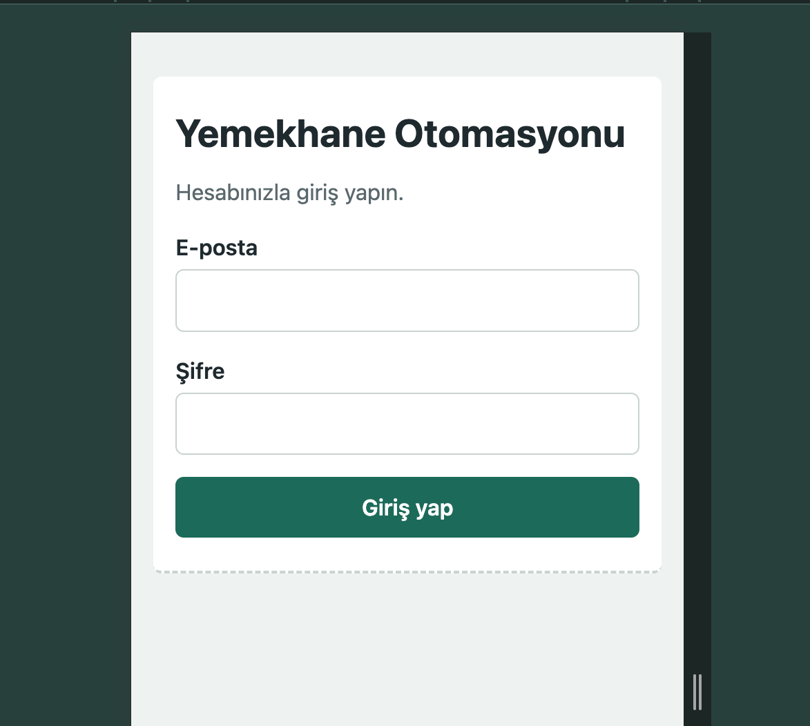

## 7. Günün menüsü ve haftalık menü

### API uçları

Üç uç da giriş gerektirir (`rotalar/menu.js` içinde `router.use(girisGerekli)`):

| Uç | Ne döner |
|---|---|
| `GET /api/menu/secenekler` | Süzgeçler için yemekhane ve öğün listesi |
| `GET /api/menu/gunluk?tarih=&yemekhane=&ogun=` | Bir günün menüleri; parametrelerin hepsi isteğe bağlı, tarih verilmezse bugün |
| `GET /api/menu/haftalik?baslangic=` | Başlangıç gününden itibaren 7 günün menüleri |

Katmanların payı:

- **Veri katmanı** (`veri/menuVeri.js`) · `v_menu_detay` (yemek başına bir satır) ile `v_menu_doluluk`
  (boş yer, kapasite) view'larını birleştiren tek bir SELECT çalıştırır, satırları menü başına
  gruplar ve toplam kaloriyi toplar. Listeleme olduğu için `okumaHavuzu` (replika) kullanılır.
  "Bugün" ve "şu an" da veritabanından (`CURDATE()`, `NOW()`) alınır; böylece uygulama ile
  rezervasyon yordamı aynı saati kullanır.
- **Controller** (`controllers/menuController.js`) · girdiyi denetler (tarih `YYYY-AA-GG` biçiminde
  ve takvimde var olan bir gün mü, kimlikler pozitif tamsayı mı) ve iki iş kuralını uygular:

```js
// Fiyat rolüne göre seçilir; öğrenci dışındakiler personel fiyatını öder (sp_rezervasyon_yap ile aynı kural)
const fiyat = kullanici.rol === 'ogrenci' ? ogrenci_fiyati : personel_fiyati;

// Rezervasyon neden kapalı? Sınır ve mesajlar sp_rezervasyon_yap ile aynıdır
let pasifNeden = null;
if (simdi >= menu.rezervasyon_son) {
  pasifNeden = 'Bu menü için rezervasyon süresi doldu.';
} else if (menu.bos_yer <= 0) {
  pasifNeden = 'Yemekhane kapasitesi dolu.';
}
```

Yanıtta yalnızca kullanıcının ödeyeceği `fiyat` bulunur, diğer fiyat arayüze hiç gönderilmez.
`rezervasyon_acik` ve `pasif_neden` alanları da sunucuda hesaplanır; arayüz bu kararı vermez,
yalnızca düğmeyi buna göre açar ya da pasif yapar.

### Doğrulama (Apache üzerinden, 24.11.2026 saat 17:00)

```
> curl -s $U/menu/gunluk
{"hata":"Bu işlem için giriş yapmalısınız."}  -> HTTP 401

> curl -s -b ogrenci "$U/menu/gunluk?tarih=2026-11-25&yemekhane=1&ogun=2"
[{"tarih": "2026-11-25", "yemekhane": "Merkez Yemekhane", "ogun": "Öğle", "fiyat": "40.00",
  "bos_yer": 394, "toplam_kalori": 1080, "rezervasyon_acik": true, "pasif_neden": null}]

> curl -s -b personel "$U/menu/gunluk?tarih=2026-11-25&yemekhane=1&ogun=2"
[{"tarih": "2026-11-25", "yemekhane": "Merkez Yemekhane", "ogun": "Öğle", "fiyat": "90.00",
  "bos_yer": 394, "toplam_kalori": 1080, "rezervasyon_acik": true, "pasif_neden": null}]

> curl -s -b ogrenci "$U/menu/gunluk?yemekhane=1&ogun=2"
[{"tarih": "2026-11-24", "yemekhane": "Merkez Yemekhane", "ogun": "Öğle", "fiyat": "40.00",
  "bos_yer": 393, "toplam_kalori": 1110, "rezervasyon_acik": false,
  "pasif_neden": "Bu menü için rezervasyon süresi doldu."}]

> curl -s -b ogrenci $U/menu/haftalik
baslangic=2026-11-24  menu=42  gunler=2026-11-24..2026-11-30 (7 gun)  acik=36  pasif=6

> curl -s -b ogrenci "$U/menu/gunluk?tarih=2026-02-30"
{"hata":"Geçersiz tarih. Biçim: YYYY-AA-GG."}  -> HTTP 400

> curl -s -b ogrenci "$U/menu/gunluk?yemekhane=abc"
{"hata":"Geçersiz yemekhane ya da öğün."}  -> HTTP 400

> curl -s -b ogrenci "$U/menu/gunluk?tarih=2026-12-05"
{"tarih":"2026-12-05","menuler":[]}  -> HTTP 200
```

(`ogrenci` = Mehmet Yıldız, `personel` = Murat Kaya oturum çerezi. Okunabilirlik için menü
yanıtlarından yemek listesi çıkarıldı, haftalık yanıt özetlendi.) Aynı menü öğrenciye 40 TL,
personele 90 TL olarak dönüyor. Bugünün öğle menüsünün son saati (10:00) geçtiği için kapalı,
yarınki açık. Haftanın 42 menüsünden yalnızca bugünün 6 menüsü kapalı. Takvimde olmayan tarih
ve bozuk kimlik 400 ile reddediliyor; menüsü olmayan gün hata değil, boş liste.

### Arayüz

Giriş sonrası sayfaların hepsi ayrı HTML dosyasıdır ve aynı gezinme çubuğunu kullanır:

| Dosya | Görevi |
|---|---|
| `frontend/js/gezinme.js` | Üst çubuk. Önce `GET /api/ben` çağrılır; giriş yoksa (401) giriş sayfasına yönlendirir, varsa bağlantıları, kullanıcı adını ve "Çıkış" düğmesini çizer |
| `frontend/js/menuKarti.js` | Bir menüyü kart olarak çizer (öğün, fiyat, yemekler, kalori, vejetaryen ve alerjen bilgisi, toplam kalori, boş yer, son saat). İki sayfa da bunu kullanır |
| `frontend/menu.html` + `js/menu.js` | Günün menüsü: tarih, yemekhane ve öğün süzgeci; biri değişince `GET /api/menu/gunluk` yeniden çağrılır |
| `frontend/haftalik.html` + `js/haftalik.js` | Haftalık menü: 7 gün, güne göre gruplu; her kartın altında rezervasyon düğmesi |
| `frontend/css/sayfa.css` | Bu sayfaların ortak stili (renkler `temel.css`'ten) |

- Tarih kutusu ilk açılışta boş gönderilir; sunucu bugünü kendi saatinden seçer ve sayfa bu tarihi
  kutuya yazar. Tarayıcının saati yanlış olsa da doğru gün gelir.
- Fiyat arayüzde hesaplanmaz; sunucudan gelen `fiyat` yalnızca `₺40,00` biçiminde yazılır.
- `rezervasyon_acik` false ise düğme `disabled` olur ve altında sunucunun `pasif_neden` mesajı
  yazar (ekran okuyucular için `aria-describedby` ile düğmeye bağlıdır). Düğmenin rezervasyon isteği
  8. bölümde bağlanacaktır.
- Bütün metinler `textContent` ile yazılır; yemek adında HTML olsa bile çalışmaz.

Günün menüsü, süzgeçler "Tümü": iki yemekhanenin üç öğünü, öğrenci fiyatıyla:

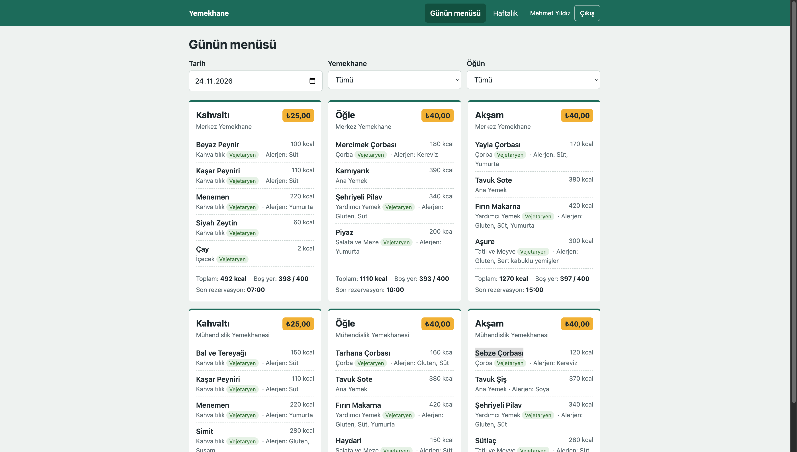

Süzgeçli görünüm (Merkez Yemekhane, öğle):

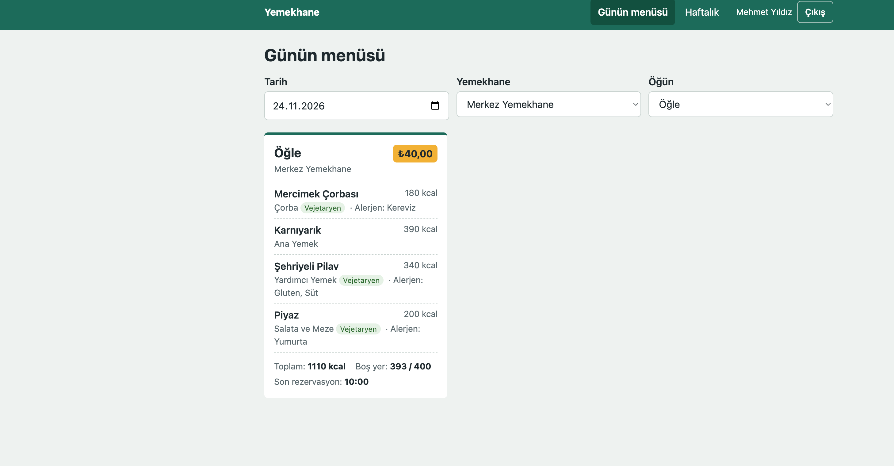

Haftalık menü: bugünün kartlarında süresi dolduğu için düğme pasif ve nedeni yazıyor, yarınki
kartlarda düğme açık:

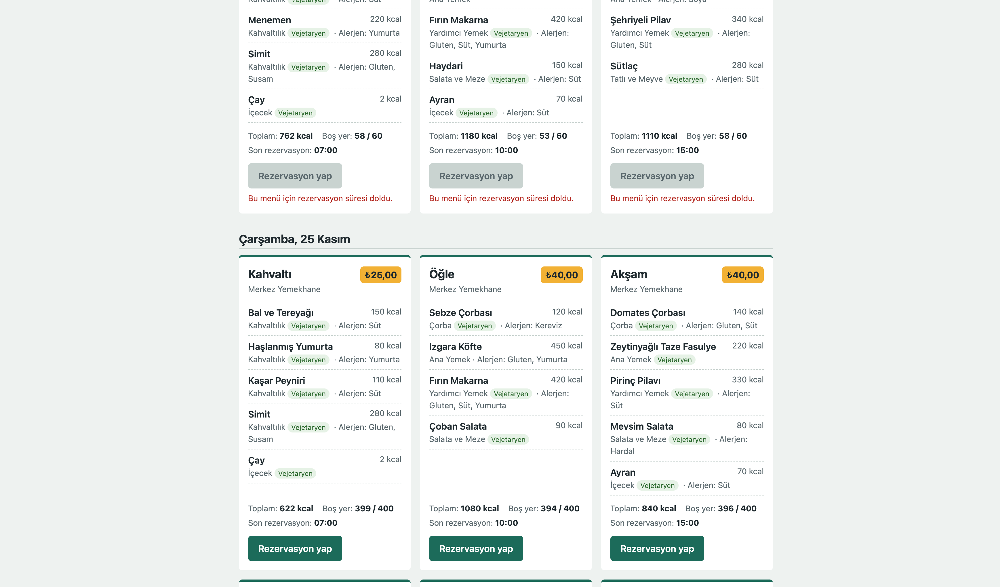

Telefon genişliği (yaklaşık 400 px): süzgeçler alt alta, kartlar tek sütun, gezinme çubuğu iki
satıra iniyor:

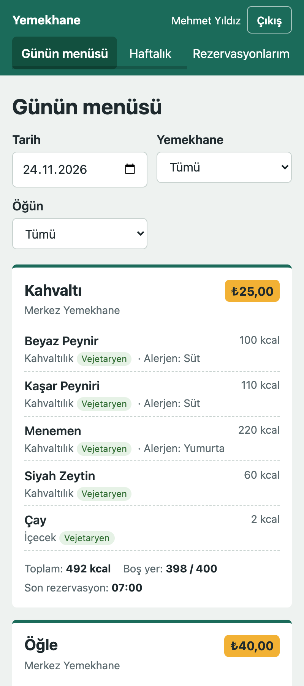

## 8. Rezervasyon ve iptal

### API uçları

| Uç | Sunucu | Ne yapar |
|---|---|---|
| `POST /api/rezervasyonlar` (gövde `{"menu_id": 50}`) | Kaynak | `sp_rezervasyon_yap` çağırır; `rezervasyon_id`, `ucret`, `bakiye` döner |
| `GET /api/rezervasyonlar` | Replika | Kullanıcının rezervasyonları; `iptal_edilebilir` alanı Controller'da hesaplanır |
| `POST /api/rezervasyonlar/:id/iptal` | Kaynak | `sp_rezervasyon_iptal` çağırır; `iade`, `bakiye` döner |

Menü uçlarına ayrıca her menü için `rezervasyonum` alanı eklendi (kullanıcının o menüde aktif ya da
kullanılmış rezervasyonu var mı). Böylece sayfa yenilendiğinde de düğme "Rezervasyonunuz var"
olarak görünür.

### Stored procedure kullanan bir isteğin yolu: `POST /api/rezervasyonlar`

**1. Route** · `rotalar/rezervasyon.js`; önce giriş denetimi, sonra Controller:

```js
app.use('/api/rezervasyonlar', rezervasyonRotalari);   // index.js
router.use(girisGerekli);                                // rotalar/rezervasyon.js
router.post('/', rezervasyon.yap);
```

**2. Controller** · `controllers/rezervasyonController.js` girdiyi denetler. Kullanıcı kimliği
istek gövdesinden değil **oturumdan** alınır; kimse başkası adına rezervasyon yapamaz. Rezervasyon
kurallarından hiçbiri burada yoktur:

```js
const menuId = req.body?.menu_id;
if (!gecerliKimlik(menuId)) {
  return res.status(400).json({ hata: 'Geçersiz menü.' });
}
const sonuc = await rezervasyonVeri.rezervasyonYap(req.session.kullanici.id, menuId);
res.status(201).json(sonuc);
```

**3. Veri katmanı** · `veri/rezervasyonVeri.js`. Yazma işlemi olduğu için kaynağa bağlı
`yazmaHavuzu` kullanılır. Süre, aynı menüye ikinci kayıt, kapasite ve bakiye kontrolü, ücretin
düşülmesi ve bakiye hareketinin yazılması yordamın içinde, tek transaction'da ve satır kilitleriyle
(`FOR UPDATE`) yapılır:

```js
const [sonuclar] = await yazmaHavuzu.execute('CALL sp_rezervasyon_yap(?, ?)', [kullaniciId, menuId]);
return sonuclar[0][0];   // { rezervasyon_id, ucret, bakiye }
```

**4. Yanıt ya da hata** · Başarılıysa 201 ve yordamın döndürdüğü satır. Bir kural çiğnenirse yordam
`SIGNAL SQLSTATE '45000'` ile Türkçe bir mesaj fırlatır; hata Controller'da yakalanmaz, `index.js`'teki
hata ara katmanına düşer ve mesaj olduğu gibi arayüze iletilir. Bu tek kural dört yordamın hepsi
için geçerlidir:

```js
if (err.sqlState === '45000') {
  return res.status(409).json({ hata: err.sqlMessage });
}
```

### Doğrulama (Apache üzerinden)

Rezervasyon:

```
> giriş yok, menu 50
{"hata":"Bu işlem için giriş yapmalısınız."}  -> HTTP 401
> mehmet (öğrenci), yarın öğle, menu 50
{"rezervasyon_id":368,"ucret":"40.00","bakiye":"315.00"}  -> HTTP 201
> mehmet, aynı menü ikinci kez
{"hata":"Bu menü için zaten rezervasyonunuz var."}  -> HTTP 409
> mehmet, bugünkü öğle, menu 44
{"hata":"Bu menü için rezervasyon süresi doldu."}  -> HTTP 409
> ayşe (bakiye 12,50), yarın kahvaltı 25 TL, menu 49
{"hata":"Bakiye yetersiz."}  -> HTTP 409
> olmayan menü, menu 99999
{"hata":"Menü bulunamadı."}  -> HTTP 409
> bozuk menu_id ("abc")
{"hata":"Geçersiz menü."}  -> HTTP 400
> bozuk JSON
{"hata":"İstek gövdesi geçerli JSON değil."}  -> HTTP 400
```

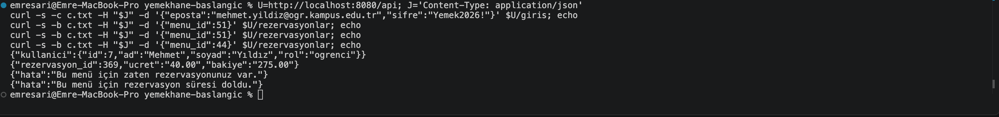

Yazmanın kaynağa gittiği ve replikaya geçtiği, iki sunucu ayrı ayrı sorgulanarak görüldü
(368 numaralı rezervasyon, Mehmet'in bakiyesi 355 → 315 TL):

```
== mysql-primary (server_id 1)
id   menu_id  durum  ucret  bakiye          tur          tutar   rezervasyon_id
368  50       aktif  40.00  315.00          rezervasyon  -40.00  368
== mysql-replica (server_id 2)
id   menu_id  durum  ucret  bakiye          tur          tutar   rezervasyon_id
368  50       aktif  40.00  315.00          rezervasyon  -40.00  368
```

Listeleme ve iptal:

```
> mehmet, GET /rezervasyonlar (özet)
14 kayıt: 10 aktif (hepsi iptal_edilebilir=true), 3 kullanildi, 1 iptal (iptal_edilebilir=false)
> mehmet, 369 numarayı iptal (yarın akşam)
{"rezervasyon_id":369,"iade":"40.00","bakiye":"315.00"}  -> HTTP 200
> mehmet, 369 tekrar iptal
{"hata":"Yalnızca aktif rezervasyonlar iptal edilebilir."}  -> HTTP 409
> mehmet, 136 iptal (kullanıldı)
{"hata":"Yalnızca aktif rezervasyonlar iptal edilebilir."}  -> HTTP 409
> mehmet, 211 iptal (başka kullanıcının)
{"hata":"Rezervasyon bulunamadı."}  -> HTTP 409
> hande, 185 iptal (bugün kahvaltı, 07:00 geçti)
{"hata":"Bu rezervasyon için iptal süresi doldu."}  -> HTTP 409
> mehmet, abc iptal
{"hata":"Geçersiz rezervasyon."}  -> HTTP 400
> mehmet, iptal edilen menüye (51) yeniden rezervasyon
{"rezervasyon_id":369,"ucret":"40.00","bakiye":"275.00"}  -> HTTP 201
```

Başka bir kullanıcının rezervasyonu "bulunamadı" olarak yanıtlanır; böylece o numaralı bir kaydın
var olduğu bile öğrenilemez. İptal edilen menüye yeniden rezervasyon yeni satır açmaz, eski kayıt
yeniden aktif olur (şemadaki `UNIQUE (kullanici_id, menu_id)`).

### Rezervasyondan sonraki bakiye neden kaynaktan okunur? (replikasyon gecikmesi)

Replika, kaynakta yapılan değişiklikleri asenkron olarak alır: kaynak bir transaction'ı commit
ettiğinde bunu ikili günlüğüne (binlog) yazar, replika bu kaydı ağ üzerinden çeker, kendi relay
günlüğüne yazar ve ardından uygular. Bu zincir genellikle milisaniyeler sürse de sıfır değildir;
yoğun yük, uzun bir transaction ya da ağ gecikmesi olduğunda saniyelere çıkabilir. Rezervasyondan
hemen sonra bakiyeyi replikadan okusaydık, değişiklik henüz oraya ulaşmamışsa kullanıcı eski
bakiyesini (ücret düşülmemiş hâlini) görürdü; parasının çekilmediğini sanıp aynı işlemi tekrar
deneyebilirdi. Bu yüzden rezervasyon ve iptalden sonra gösterilen bakiye replikadan okunmaz:
`sp_rezervasyon_yap` ve `sp_rezervasyon_iptal` yeni bakiyeyi kendi transaction'ları içinde, kaynakta
hesaplayıp döndürür ve arayüz bu değeri gösterir. Aynı nedenle arayüz, rezervasyon ya da iptalden
sonra listeyi replikadan yeniden çekmez; yalnızca işlem yapılan kartı ya da satırı günceller.
Listeleme gibi birkaç saniyelik eskiliğin zarar vermediği okumalar ise replikaya gider ve kaynağın
yükünü azaltır.

### Arayüz

**Haftalık menü** (`js/haftalik.js`): "Rezervasyon yap" düğmesi `POST /api/rezervasyonlar` çağırır.
Başarılıysa düğme "Rezervasyonunuz var" olup pasifleşir ve altında ücret ile kaynaktan gelen kalan
bakiye yazar; hata olursa yordamın mesajı kartın altında kırmızıyla gösterilir.


Bakiyesi 12,50 TL olan öğrenci 25 TL'lik kahvaltıyı ayırtmaya çalışıyor; mesaj yordamdan gelir:

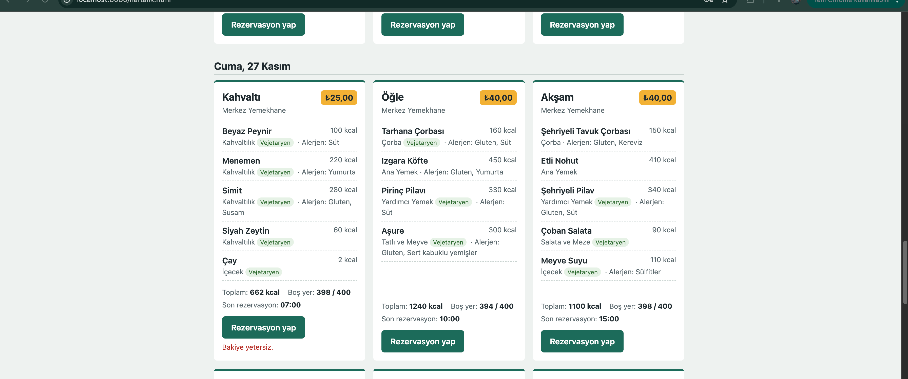

**Rezervasyonlarım** (`rezervasyonlarim.html`, `js/rezervasyonlarim.js`): her rezervasyon tarih,
yemekhane, öğün, ücret ve durum etiketiyle (Aktif, Kullanıldı, İptal edildi) listelenir. "İptal et"
düğmesi yalnızca sunucunun `iptal_edilebilir: true` dediği satırlarda bulunur; arayüz tarih ya da
saat karşılaştırmaz. İptal önce onay ister; geri alınması zor bir eylem olduğu için düğme ana renkte
değil, kırmızı çerçevelidir.

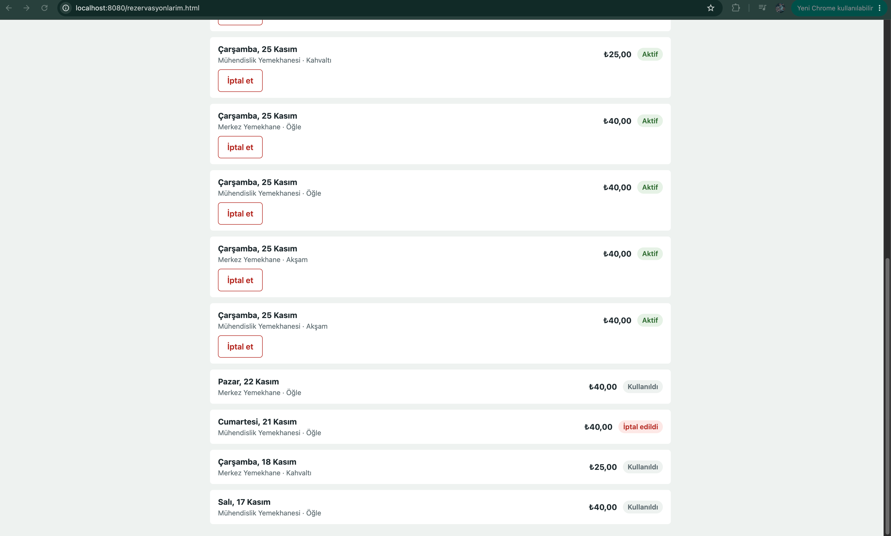

İptalden sonra satırın durumu "İptal edildi" olur, iade ve yeni bakiye yazar:

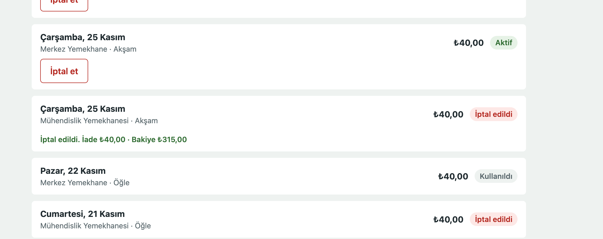

Telefon genişliği (yaklaşık 400 px):

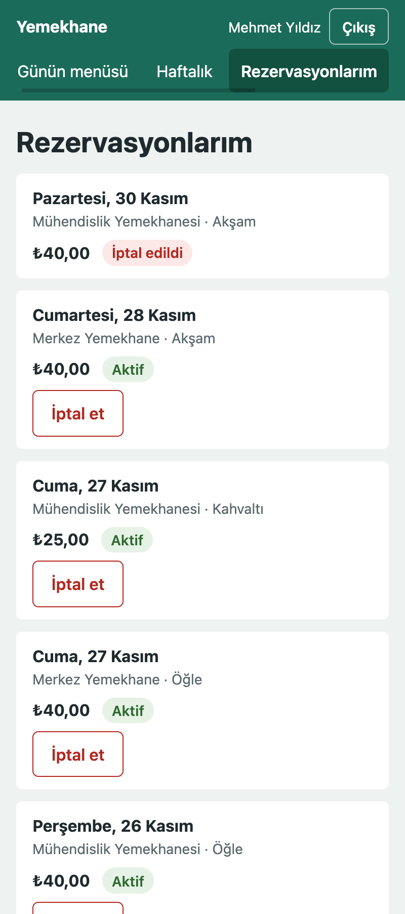

Para, saat ve gün biçimleri üç sayfanın ortak kullandığı `js/bicim.js`'e taşındı.

## 9. Bakiye ve değerlendirme

### Bakiye

| Uç | Sunucu | Ne yapar |
|---|---|---|
| `GET /api/bakiye` | Replika | Güncel bakiye ve son 100 hareket; rezervasyon/iade hareketlerinde menünün tarihi, öğünü, yemekhanesi |
| `POST /api/bakiye/yukle` (gövde `{"tutar": 100}`) | Kaynak | `sp_bakiye_yukle` çağırır; `hareket_id`, `bakiye` döner |

Controller tutarın yalnızca **biçimini** denetler (sayı mı, pozitif mi, en fazla iki ondalıklı mı).
"Tek seferde 10–1000 TL" kuralı Controller'da tekrar yazılmaz; yordamın kuralı ve Türkçe mesajı
kullanılır. Böylece kural tek yerde durur.

```
> giriş yok, GET /bakiye
{"hata":"Bu işlem için giriş yapmalısınız."}  -> HTTP 401
> mehmet, GET /bakiye (özet)
bakiye = 315.00 | hareket sayısı = 21 | hareketlerin toplamı = 315.00
> mehmet, 100 TL yükle
{"hareket_id":462,"bakiye":"415.00"}  -> HTTP 201
> mehmet, 5 TL yükle
{"hata":"Yükleme tutarı 10 ile 1000 TL arasında olmalıdır."}  -> HTTP 409
> mehmet, 1500 TL yükle
{"hata":"Yükleme tutarı 10 ile 1000 TL arasında olmalıdır."}  -> HTTP 409
> mehmet, 12.555 TL yükle
{"hata":"Geçersiz tutar."}  -> HTTP 400
> mehmet, "100" (metin)
{"hata":"Geçersiz tutar."}  -> HTTP 400
> mehmet, -50 TL yükle
{"hata":"Geçersiz tutar."}  -> HTTP 400
```

Hareketlerin toplamı bakiyeye eşittir (şemadaki `kullanicilar.bakiye = SUM(bakiye_hareketleri.tutar)`
kuralı). Bakiye ekranında (`bakiye.html`, `js/bakiye.js`) yüklemeden sonra bakiye yordamın kaynakta
hesapladığı değerle güncellenir ve yeni hareket tablonun başına "Az önce" olarak eklenir; liste,
8. bölümde anlatılan replikasyon gecikmesi nedeniyle replikadan yeniden çekilmez.

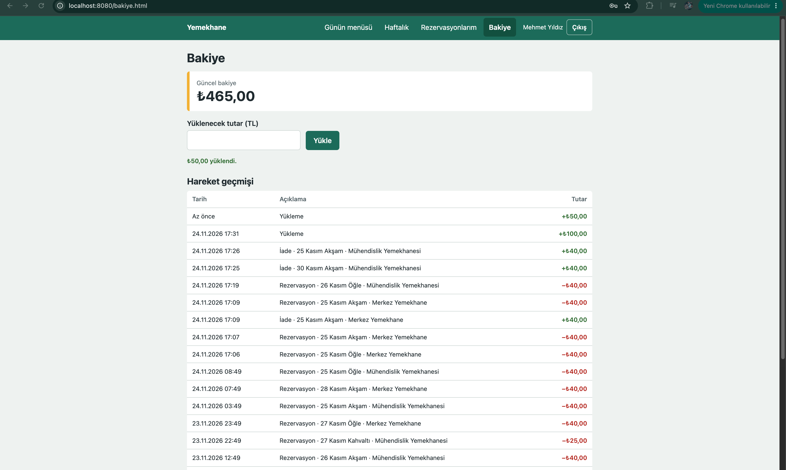

Yordamın reddettiği tutar:

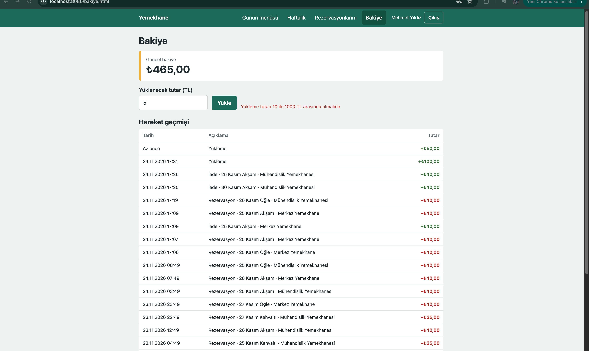

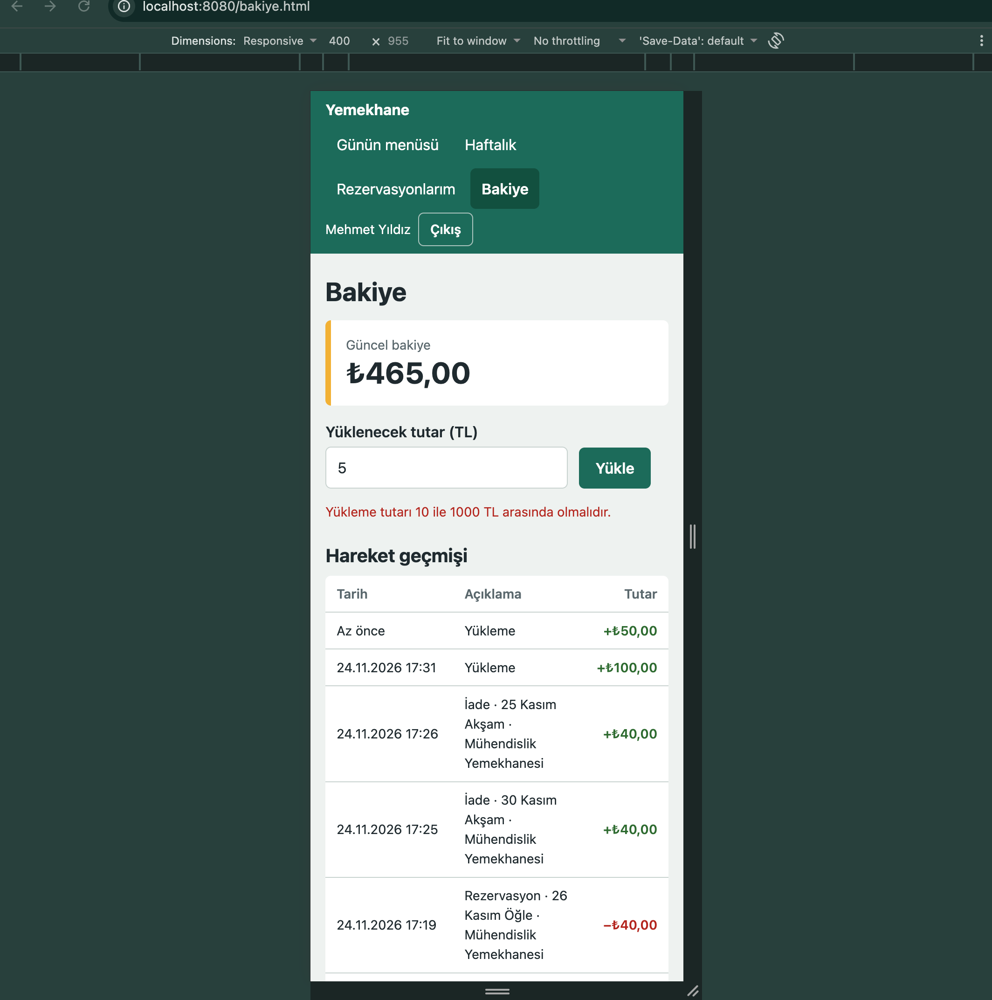

### Değerlendirme

| Uç | Sunucu | Ne yapar |
|---|---|---|
| `GET /api/degerlendirmeler` | Replika | Kullanıcının **kullanılmış** rezervasyonlarının menüleri ve varsa verdiği puan/yorum |
| `POST /api/degerlendirmeler` (gövde `{"menu_id": 5, "puan": 4, "yorum": "..."}`) | Kaynak | Değerlendirmeyi kaydeder |

Bu iş için stored procedure yoktur; şema "*Yalnızca kullanılmış menü değerlendirilir kuralı
uygulamaya aittir*" der. Kural `controllers/degerlendirmeController.js` içinde uygulanır:

```js
// İş kuralı: yalnızca kullanılmış (turnikeden geçilmiş) menü değerlendirilir
if (!(await degerlendirmeVeri.menuyuKullandiMi(kullaniciId, menuId))) {
  return res.status(403).json({ hata: 'Yalnızca kullandığınız menüleri değerlendirebilirsiniz.' });
}
const id = await degerlendirmeVeri.degerlendirmeEkle(kullaniciId, menuId, puan, temizYorum);
if (id === null) {
  return res.status(409).json({ hata: 'Bu menüyü zaten değerlendirdiniz.' });
}
```

- **Kontrol için yapılan okuma kaynaktandır.** `menuyuKullandiMi` bir SELECT olsa da bir yazma
  kararının dayanağıdır; turnikeden yeni geçmiş bir kullanıcının rezervasyonu replikada henüz
  `kullanildi` olmayabilir ve kullanıcı haksız yere reddedilirdi. Bu yüzden `yazmaHavuzu` kullanır.
  Ekrandaki liste ise replikadan okunur.
- Puan 1–5 ve "kişi başına menü başına tek oy" veritabanında da güvence altındadır (`CHECK`,
  `UNIQUE`). İkinci oyda gelen `ER_DUP_ENTRY` hatası veri katmanında yakalanıp `null`'a çevrilir;
  MySQL'e özgü hata kodu Controller'a sızmaz.
- Puan, yorum uzunluğu (en fazla 500 karakter, `VARCHAR(500)`) Controller'da denetlenir; arayüz bu
  sınırları tekrar yazmaz, sunucunun mesajını gösterir.

```
> giriş yok, GET /degerlendirmeler
{"hata":"Bu işlem için giriş yapmalısınız."}  -> HTTP 401
> menü 5 (kullanıldı), 4 puan + yorum
{"menu_id":5,"puan":4,"yorum":"Karnıyarık çok iyiydi."}  -> HTTP 201
> menü 5 tekrar
{"hata":"Bu menüyü zaten değerlendirdiniz."}  -> HTTP 409
> menü 32 (önceden 2 puan verilmiş)
{"hata":"Bu menüyü zaten değerlendirdiniz."}  -> HTTP 409
> menü 50 (rezervasyon aktif, kullanılmadı)
{"hata":"Yalnızca kullandığınız menüleri değerlendirebilirsiniz."}  -> HTTP 403
> menü 1 (rezervasyonu yok)
{"hata":"Yalnızca kullandığınız menüleri değerlendirebilirsiniz."}  -> HTTP 403
> puan 6
{"hata":"Puan 1 ile 5 arasında bir tamsayı olmalıdır."}  -> HTTP 400
> puan 3.5
{"hata":"Puan 1 ile 5 arasında bir tamsayı olmalıdır."}  -> HTTP 400
> yorum 501 karakter
{"hata":"Yorum en fazla 500 karakter olabilir."}  -> HTTP 400
```

Kayıt replikaya geçti ve menünün ortalaması `v_menu_puan` view'ına yansıdı
(menü 5: `oy_sayisi 2, ortalama_puan 3.50`).

Değerlendirme ekranında (`degerlendirme.html`, `js/degerlendirme.js`) kullanılmış her menü bir kart
olarak görünür; değerlendirilmişse yıldızlar ve yorum, değilse yıldız seçici ve yorum kutusu. Yıldızlar
gizlenmiş radio düğmeleridir; fareyle ya da klavyeyle (Tab, ok tuşları) seçilebilir ve ekran okuyucu
"5 üzerinden 4 puan" diye okur.

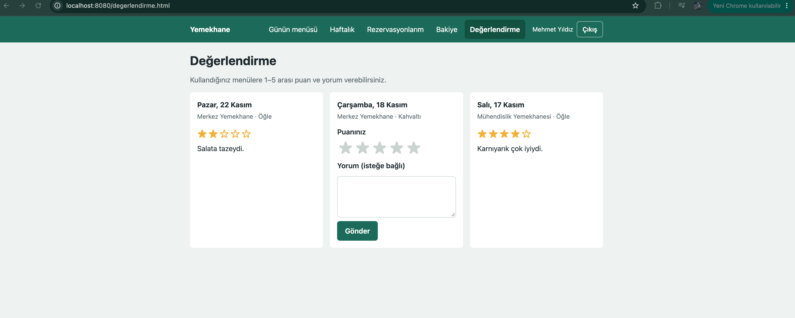

Gönderildikten sonra form, kaydedilen puan ve yorumla yer değiştirir:

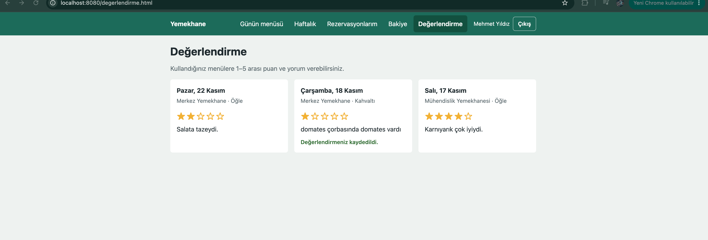

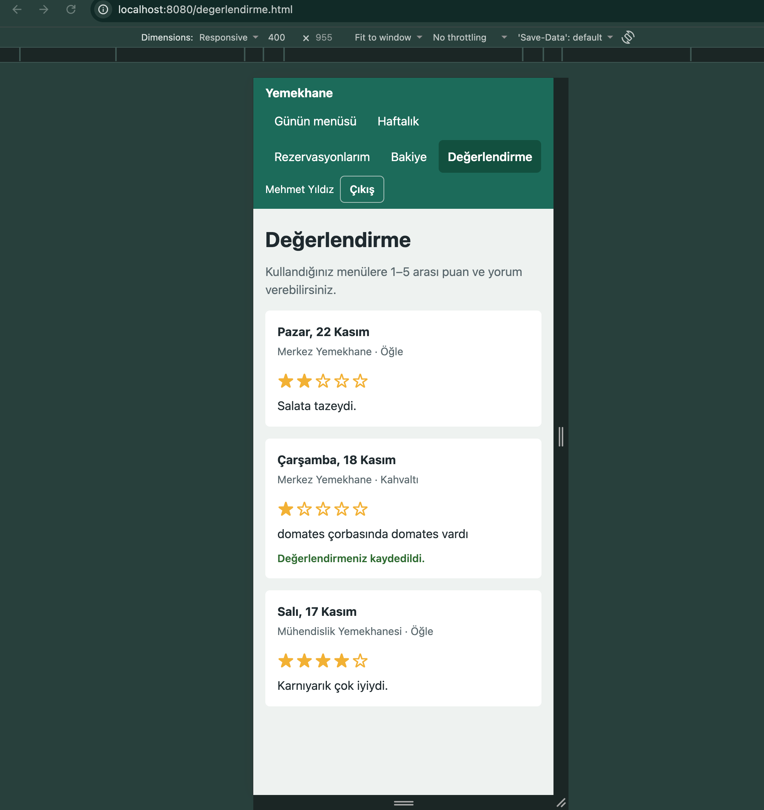

## 10. Yönetici paneli

### Yetki

`ara/yoneticiGerekli.js` ara katmanı `/api/yonetim/...` altındaki bütün uçların önünde durur: giriş
yoksa **401** (kim olduğu bilinmiyor), giriş var ama rol `yonetici` değilse **403** (kim olduğu
biliniyor, yetkisi yok). Gezinme çubuğundaki "Yönetim" bağlantısı yalnızca yöneticiye gösterilir; bu
yalnızca görünümdür, asıl koruma sunucudadır. Öğrenci adresi elle yazsa da API 403 döner ve sayfa bu
mesajı gösterir.

### API uçları

| Uç | Sunucu | Ne yapar |
|---|---|---|
| `GET /api/yonetim/menuler?baslangic=` | Replika | 7 günün menüleri: iki fiyat, doluluk (`v_menu_doluluk`: rezerve / kapasite, %), ortalama puan (`v_menu_puan`: oy sayısı, ortalama) |
| `GET /api/yonetim/yemekler` | Replika | Form için kategori kategori yemek kataloğu |
| `GET /api/yonetim/menuler/:id` | Kaynak | Düzenlenecek menü (yazmanın dayanağı olan okuma) |
| `POST /api/yonetim/menuler` | Kaynak | Yeni menü ve yemekleri, tek transaction |
| `PUT /api/yonetim/menuler/:id` | Kaynak | Fiyatlar ve yemek listesi, tek transaction |

Controller'daki kurallar: yeni menünün tarihi bugünden önce olamaz; geçmiş menü düzenlenemez;
fiyatlar sıfır ya da pozitif ve en fazla iki ondalıklı; en az bir yemek seçilir. Düzenlemede
yemekhane, tarih ve öğün değiştirilemez (o menüye rezervasyon yapılmış olabilir). Fiyat değişikliği
mevcut rezervasyonları etkilemez, çünkü her rezervasyon ödediği ücreti kendi satırında
(`rezervasyonlar.ucret`) saklar. Menü silme bilerek yoktur: ödev "oluşturma ve düzenleme" ister ve
rezervasyonu olan bir menünün silinmesi ödenmiş ücretleri boşta bırakırdı.

### Uygulamanın yönettiği transaction

Önceki yazma işlemlerinde transaction'ı stored procedure açıp kapatıyordu. Menü oluşturma için
yordam yoktur ve iş iki tabloya yazar (`menuler`, `menu_yemekleri`); ikisinin birlikte yazılması
gerekir. `veri/yonetimVeri.js` havuzdan tek bir bağlantı alır (transaction bağlantıya aittir) ve işi
şu yardımcıyla çalıştırır:

```js
async function transactionIcinde(is) {
  const baglanti = await yazmaHavuzu.getConnection();
  try {
    await baglanti.beginTransaction();
    const sonuc = await is(baglanti);
    await baglanti.commit();
    return sonuc;
  } catch (err) {
    await baglanti.rollback();
    throw err;
  } finally {
    baglanti.release();     // bağlantı havuza geri döner
  }
}
```

Veritabanı hataları da veri katmanında anlamlı sonuçlara çevrilir; MySQL'e özgü kodlar Controller'a
sızmaz: `ER_DUP_ENTRY` (aynı yemekhane + tarih + öğün, `uq_menu`) → 409,
`ER_NO_REFERENCED_ROW_2` (olmayan yemek) → 400.

### Doğrulama (Apache üzerinden)

```
> giriş yok, GET /yonetim/menuler
{"hata":"Bu işlem için giriş yapmalısınız."}  -> HTTP 401
> öğrenci, GET /yonetim/menuler
{"hata":"Bu işlem için yönetici yetkisi gerekir."}  -> HTTP 403
> öğrenci, POST /yonetim/menuler
{"hata":"Bu işlem için yönetici yetkisi gerekir."}  -> HTTP 403
> yönetici, GET /yonetim/menuler (bu hafta, özet)
baslangic=2026-11-24 menu=42
  44 2026-11-24 Merkez Yemekhane Öğle 40.00 90.00 7/400 %1.8 puan None (0 oy) duzenlenebilir True
> yönetici, GET /yonetim/menuler?baslangic=2026-11-17 (geçen hafta, puanlı)
  2 2026-11-17 Merkez Yemekhane Öğle 40.00 90.00 6/400 %1.5 puan 2.33 (3 oy) duzenlenebilir False
  5 2026-11-17 Mühendislik Yemekhanesi Öğle 40.00 90.00 5/60 %8.3 puan 3.50 (2 oy) duzenlenebilir False
> yönetici, GET /yonetim/yemekler
7 kategori, 52 yemek
> yeni menü: 1 Aralık, Merkez, Öğle, 40/90, yemekler [1,14,23]
{"menu_id":85}  -> HTTP 201
> aynı menü tekrar
{"hata":"Bu yemekhane, tarih ve öğün için zaten bir menü var."}  -> HTTP 409
> geçmiş tarih (20 Kasım)
{"hata":"Geçmiş bir tarihe menü eklenemez."}  -> HTTP 400
> yemeksiz menü
{"hata":"En az bir yemek seçmelisiniz."}  -> HTTP 400
> eksi fiyat
{"hata":"Fiyatlar sıfır ya da pozitif, en fazla iki ondalıklı sayı olmalıdır."}  -> HTTP 400
> menü 85 düzenle: 45/95, yemekler [1,14,23,30]
{"menu_id":85}  -> HTTP 200
> menü 1 (17 Kasım, geçmiş) düzenle
{"hata":"Geçmiş menüler düzenlenemez."}  -> HTTP 409
> menü 99999 düzenle
{"hata":"Menü bulunamadı."}  -> HTTP 404
> öğrenci, GET /menu/gunluk?tarih=2026-12-01
  85 Merkez Yemekhane Öğle fiyat 45.00 ['Mercimek Çorbası', 'Karnıyarık', 'Şehriyeli Pilav', 'Mevsim Salata'] acik True
```

Yöneticinin eklediği menü öğrencinin günlük menüsünde öğrenci fiyatıyla ve rezervasyona açık olarak
görünüyor; örnek verideki menüler bittiğinde (30 Kasım) yenileri panelden eklenebilir.

**Rollback kanıtı.** İki denemede yemek listesine olmayan bir yemek (9999) konuldu:

```
> ROLLBACK denemesi: 1 Aralık akşam, yemekler [1, 9999]
{"hata":"Seçilen yemekhane, öğün ya da yemeklerden biri bulunamadı."}  -> HTTP 400
> menü 85 düzenle, ROLLBACK: fiyat 10/10, yemekler [1, 9999]
{"hata":"Seçilen yemekhane, öğün ya da yemeklerden biri bulunamadı."}  -> HTTP 400

-- kaynakta 1 Aralık menüleri:
id  tarih       ogun_id  ogrenci_fiyati  personel_fiyati  yemekler
85  2026-12-01  2        45.00           95.00            1,14,23,30
```

Birinci denemede `menuler` satırı eklendikten sonra `menu_yemekleri` hata verdi; transaction geri
alındığı için yemeksiz bir akşam menüsü kalmadı (kaynakta 1 Aralık için yalnızca öğle menüsü var).
İkinci denemede fiyatlar önce 10/10 yapıldı, ardından yemek eklenirken hata çıktı; fiyatlar 45/95'te,
yemekler eski hâlinde kaldı.

### Arayüz

`yonetim.html` (`js/yonetim.js`): haftalık rapor tablosu (tarih, yemekhane · öğün, öğrenci / personel
fiyatı, doluluk çubuğu, ★ ortalama · oy sayısı), önceki/sonraki hafta düğmeleri. Bugünün ve sonraki
günlerin menülerinde "Düzenle" bağlantısı, geçmiştekilerde "Geçmiş" yazar; bu karar sunucudan gelen
`duzenlenebilir` alanına göre verilir.

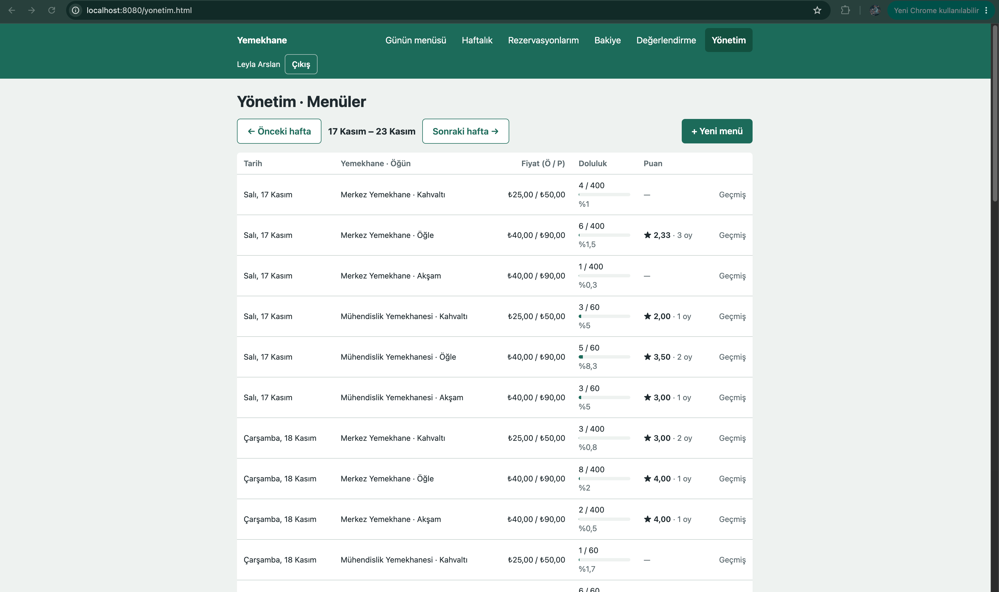

`yonetim-menu.html` (`js/yonetim-menu.js`): tek form, iki iş: adreste `?id=` yoksa yeni menü, varsa
düzenleme (yemekhane, tarih, öğün kilitli). Yemekler kategori kategori onay kutularıyla seçilir.
Yeni menü kaydedilince sayfa düzenleme moduna geçer. Panelden eklenen menü listede:

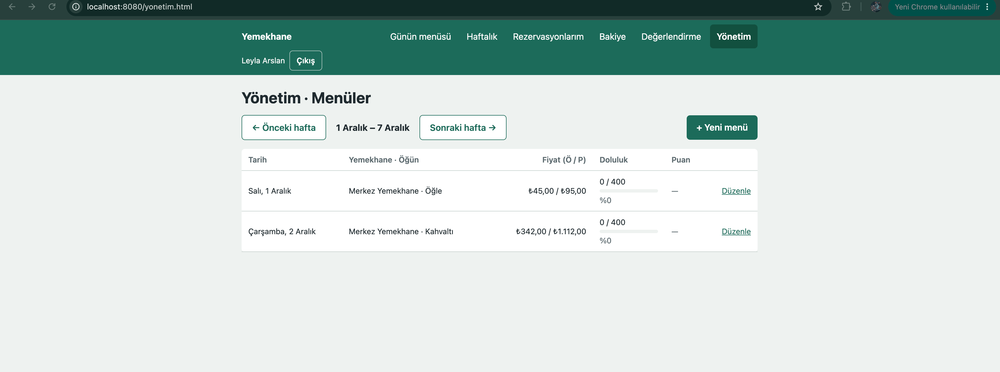

Aynı yemekhane, tarih ve öğün için ikinci menü:

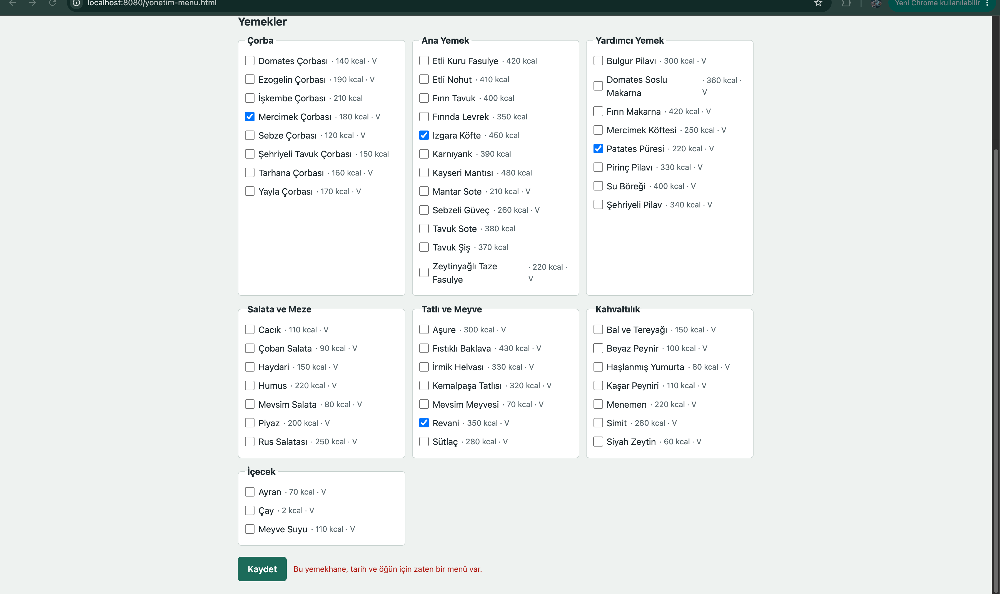

Öğrenci adresi elle yazdığında (bağlantı çubukta görünmez):

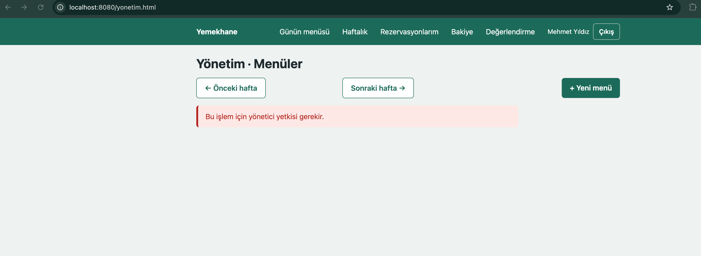

Telefon genişliği: tablo kendi alanında yana kaydırılır, sayfa taşmaz:


## 11. Hata mesajlarının arayüze taşınması

### Bir iş kuralı hatasının yolu

İş kuralları stored procedure'lerdedir. Bir kural çiğnenince yordam `SIGNAL SQLSTATE '45000'` ile
Türkçe bir mesaj fırlatır. Bu mesaj hiçbir katmanda yeniden yazılmaz, olduğu gibi kullanıcıya ulaşır:

```
sp_rezervasyon_yap            SIGNAL SQLSTATE '45000' SET MESSAGE_TEXT = 'Bakiye yetersiz.'
  → rezervasyonVeri.js        mysql2 hatayı fırlatır: err.sqlState = '45000', err.sqlMessage
  → rezervasyonController.js  hatayı yakalamaz, next(err) ile Express'e bırakır
  → index.js hata ara katmanı  409 { "hata": "Bakiye yetersiz." }
  → js/api.js apiIstek        { ok: false, durum: 409, hata: "Bakiye yetersiz." }
  → js/haftalik.js            kartın altına kırmızıyla yazar, düğmeyi yeniden açar
```

Arayüzde iş kuralı yoktur. Bakiye, kapasite, süre ya da tutar sınırı tarayıcıda denetlenmez,
yalnızca sunucunun mesajı gösterilir. Böylece kural tek yerde (veritabanında) durur ve aynı kuralı
başka bir istemci (mobil uygulama, turnike) de kullanır.

### Durum kodları

| Kod | Kaynak | Örnek mesaj |
|---|---|---|
| 400 | Controller girdi denetimi | "Geçersiz tutar.", "Puan 1 ile 5 arasında bir tamsayı olmalıdır." |
| 401 | `girisGerekli` ara katmanı | "Bu işlem için giriş yapmalısınız." |
| 403 | `yoneticiGerekli`, değerlendirme kuralı | "Bu işlem için yönetici yetkisi gerekir." |
| 404 | Controller | "Menü bulunamadı." |
| 409 | Yordam (`SQLSTATE 45000`) ya da tekrar kaydı (`ER_DUP_ENTRY`) | "Bakiye yetersiz.", "Bu menüyü zaten değerlendirdiniz." |
| 503 | Veritabanına bağlanılamadı | "Veritabanına şu an ulaşılamıyor. Lütfen biraz sonra tekrar deneyin." |
| 500 | Beklenmeyen hata (ayrıntı günlüğe yazılır) | "Beklenmeyen bir hata oluştu." |

### Yordam mesajları ve göründükleri ekranlar

| Yordam | Mesaj | Ekran |
|---|---|---|
| `sp_rezervasyon_yap` | Bakiye yetersiz. · Yemekhane kapasitesi dolu. · Bu menü için rezervasyon süresi doldu. · Bu menü için zaten rezervasyonunuz var. · Menü bulunamadı. · Hesabınız pasif durumda. | Haftalık, kartın altında |
| `sp_rezervasyon_iptal` | Bu rezervasyon için iptal süresi doldu. · Yalnızca aktif rezervasyonlar iptal edilebilir. · Rezervasyon bulunamadı. | Rezervasyonlarım, satırın altında |
| `sp_bakiye_yukle` | Yükleme tutarı 10 ile 1000 TL arasında olmalıdır. · Hesabınız pasif durumda. | Bakiye, Yükle düğmesinin yanında |
| `sp_turnike_gecis` | Şu an bu yemekhanede servis yok. · Bu rezervasyon zaten kullanıldı. · Bu öğün için aktif rezervasyonunuz yok. | Web arayüzünde kullanılmaz (turnike kart okuyucudan çağrılır) |

Haftalık sayfası "süre doldu", "kapasite dolu" ve "zaten rezervasyonunuz var" durumlarını düğmeye
basılmadan da gösterir. Menü listesi bu durumları sunucudan `rezervasyon_acik` ve `pasif_neden`
alanlarıyla alır (bkz. bölüm 7). Yordamdaki denetim yine de kalır, çünkü sayfa açıldıktan sonra
kapasite dolabilir ya da süre geçebilir.

Örnekler: "Bakiye yetersiz." (bölüm 8), "Yükleme tutarı 10 ile 1000 TL arasında olmalıdır."
(bölüm 9), yönetim panelindeki "Bu yemekhane, tarih ve öğün için zaten bir menü var." (bölüm 10).

### Sunucu ya da bağlantı sorunlarında arayüz

Yordam mesajlarının yanında, isteğin sunucuya hiç ulaşmadığı ya da yarıda kaldığı durumlar da ele
alındı (`js/api.js`, `js/gezinme.js`, `js/giris.js`, `index.js`):

| Durum | Ne olur |
|---|---|
| Ağ hatası (fetch başarısız) | "Sunucuya ulaşılamıyor." |
| Uygulama kapalı (Apache JSON değil kendi 502/503 sayfasını döndürür) | "Sunucu şu an yanıt vermiyor. Lütfen biraz sonra tekrar deneyin." |
| Kaynak veritabanı kapalı | Yazma 503 ve "Veritabanına şu an ulaşılamıyor…" döner. Okumalar replikadan sürer. |
| Sayfa açılırken giriş yok (401) | Giriş sayfasına yönlendirilir |
| Sayfa açıkken oturum düştü (süre doldu ya da uygulama yeniden başladı) | Bir sonraki istekte giriş sayfasına gidilir, "Oturumunuz sona erdi. Lütfen yeniden giriş yapın." yazar |
| `/api/ben` 401 dışında bir hata döndürdü | Giriş sayfasına **atılmaz** (kullanıcı şifresini yanlış girdiğini sanmasın), mesaj sayfada gösterilir |

Giriş sayfasında yanlış şifre de 401 döndürür. Bu yüzden "401 gelince giriş sayfasına git"
davranışı `api.js`'e konmadı. `api.js` yalnızca `oturumDustu` adlı bir fonksiyon tanımlıysa onu
çağırır. Bu fonksiyon `gezinme.js`'tedir ve giriş sayfası `gezinme.js`'i yüklemez. `girisYapildi`
bayrağı da açılıştaki 401'i ("hiç giriş yapılmamış") işlem sırasındaki 401'den ("oturum düştü") ayırır.

Düzeltmeden önce oturum düştüğünde kullanıcı sayfada kalıyor, her düğmede aynı mesajı görüyordu:

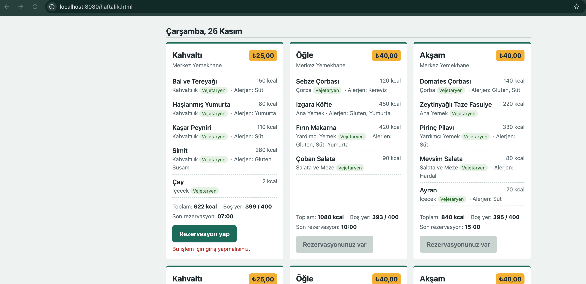

Düzeltmeden sonraki davranış sunucu tarafında curl ile doğrulandı. Uygulama yeniden başlatıldıktan
sonra eski çerezle yapılan istek 401 döndürdü. Tarayıcıdaki yönlendirme bu raporda görüntülenmedi.

### Deneme: kaynak veritabanı kapalıyken (24.11.2026)

`docker compose stop mysql-primary` ile kaynak durduruldu, replika ve uygulama açık bırakıldı:

| İstek | Havuz | Sonuç |
|---|---|---|
| `POST /api/bakiye/yukle` (50 TL) | yazma (kaynak) | 503 "Veritabanına şu an ulaşılamıyor…" |
| `GET /api/bakiye` | okuma (replika) | 200 |
| `GET /api/menu/gunluk`, `/haftalik`, `/secenekler` | okuma (replika) | 200, 3–7 ms |
| `GET /api/rezervasyonlar`, `/api/degerlendirmeler` | okuma (replika) | 200, 2–4 ms |

Bu deneme okuma/yazma ayrımını doğruluyor: kaynak gidince sistem salt okunur çalışmaya devam etti.

Kaynak yeniden başlatılınca yazma hemen çalıştı. Replika ise kaynağa 60 saniyede bir yeniden
bağlanmayı denediği için yaklaşık bir dakika eski veriyi gösterdi: kaynakta bakiye 515,00, replikada
465,00 TL. Sonra yetişti (`Seconds_Behind_Source: 0`). Bu, bölüm 8'de anlatılan replikasyon
gecikmesinin abartılmış ama gerçek bir örneği. İşlemden sonra gösterilen bakiyenin replikadan değil
yordamın kaynakta döndürdüğü değerden alınmasının nedeni de bu.

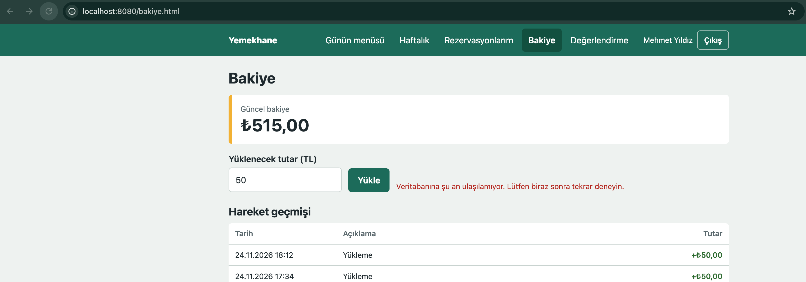

Bakiye ve hareket geçmişi replikadan okunduğu için ekranda duruyor. Yalnızca yükleme (yazma)
reddedildi.

## 12. Telefon uyumu (400 px)

Sayfalar baştan akışkan yazıldı: kartlar ve formlar `grid` ile `auto-fill` / `auto-fit` kullanır,
satırlar `flex-wrap` ile alt satıra iner, geniş tablolar `.tablo-kaydir` içinde kendi alanında yana
kayar. Bu yüzden genişliğe bağlı kırılma noktası yalnızca bir tane var (`css/sayfa.css`,
`@media (max-width: 600px)`). Bu kırılma noktası iki sorunu düzeltir.

**Gezinme çubuğu:** Bağlantı sayısı 5'e (öğrenci) ve 6'ya (yönetici) çıkınca 400 px'te gezinme
4–5 satıra iniyor ve ekranın yaklaşık dörtte birini kaplıyordu:

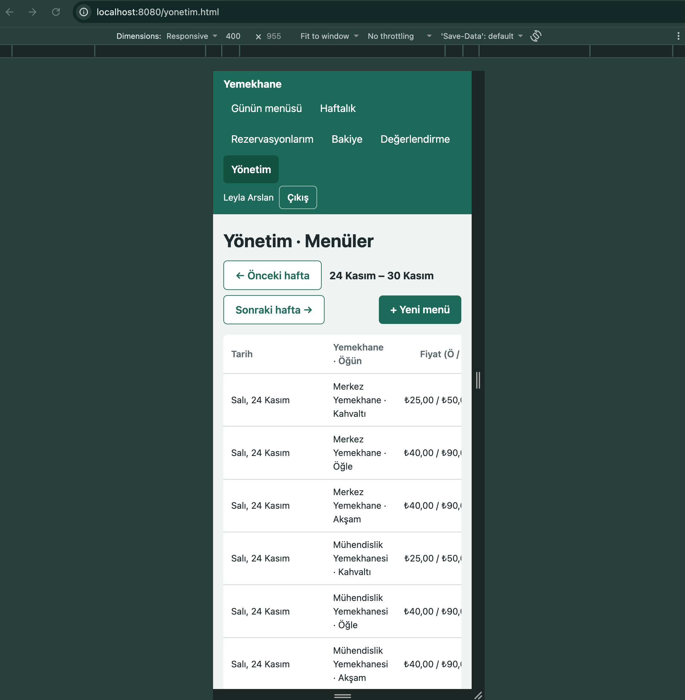

Telefonda artık üst satırda başlık ile ad ve Çıkış düğmesi duruyor. Bağlantılar alttaki tek satırda
parmakla yana kaydırılıyor (`flex-wrap: nowrap; overflow-x: auto`). `gezinme.js` aktif sayfanın
bağlantısını `scrollIntoView` ile görünür alana getiriyor. Böylece en sondaki "Yönetim" ekran
dışında kalmıyor. Gezinmenin yüksekliği her sayfada 99 px oldu. Masaüstünde bir şey değişmedi.

**Rezervasyonlarım satırları:** Fiyat ve durum etiketi, metin kısaysa yanda, uzunsa altta
duruyordu. Telefonda bilgi kısmı artık tam satır kaplıyor, fiyat ve durum her satırda altta.

### Doğrulama

Görüntüler başsız Chrome ile, 400 × 900 CSS pikselde (`deviceScaleFactor: 2`, `mobile: true`)
alındı. Her sayfada `document.documentElement.scrollWidth` ölçüldü:

| Sayfa | Kullanıcı | Sayfa genişliği | Gezinme yüksekliği |
|---|---|---|---|
| giris.html | — | 400 px | — |
| menu.html, haftalik.html, rezervasyonlarim.html, bakiye.html, degerlendirme.html | öğrenci | 400 px | 99 px |
| yonetim.html, yonetim-menu.html | yönetici | 400 px | 99 px |

Sayfa genişliği pencere genişliğine (400 px) eşit, yani hiçbir sayfada yatay taşma yok. Yönetim
tablosu sayfayı değil yalnızca kendi alanını yana kaydırıyor.

Bölüm 7–10'daki telefon görüntüleri de bu yöntemle yeniden alındı. Ek olarak:

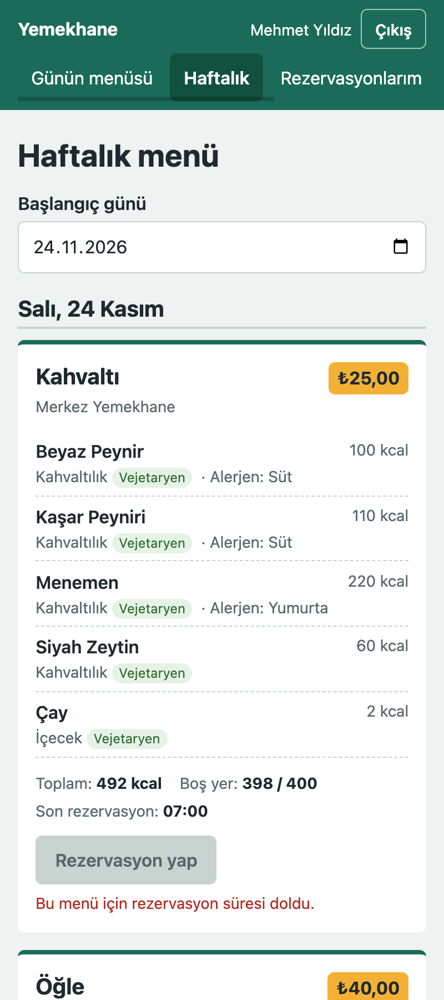

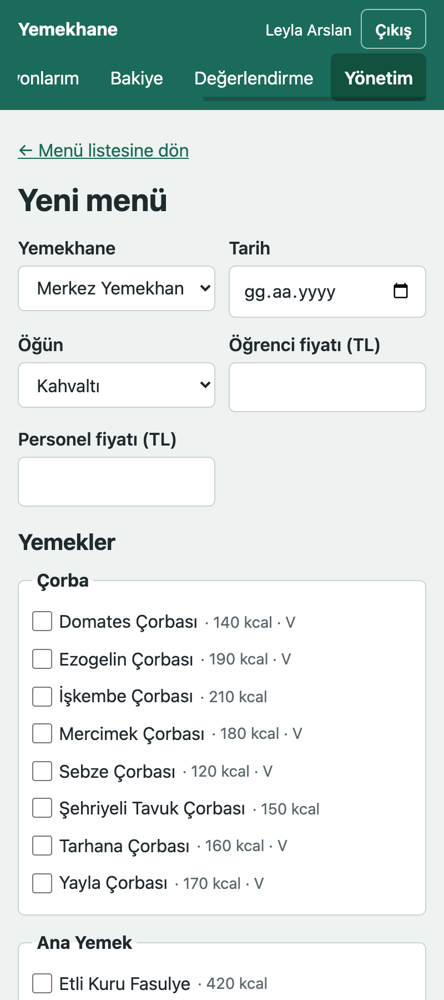
