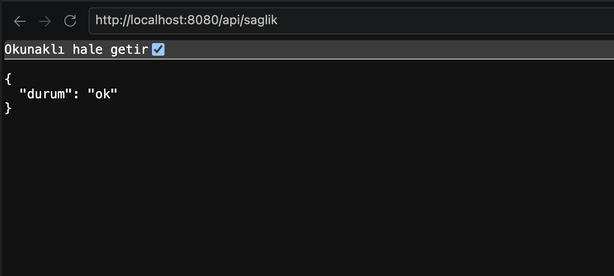
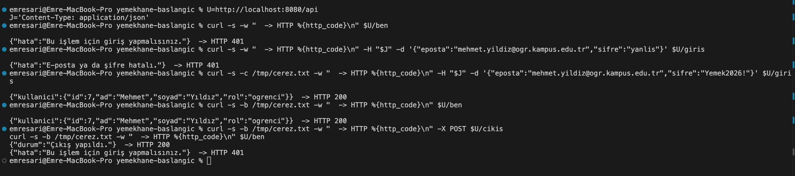
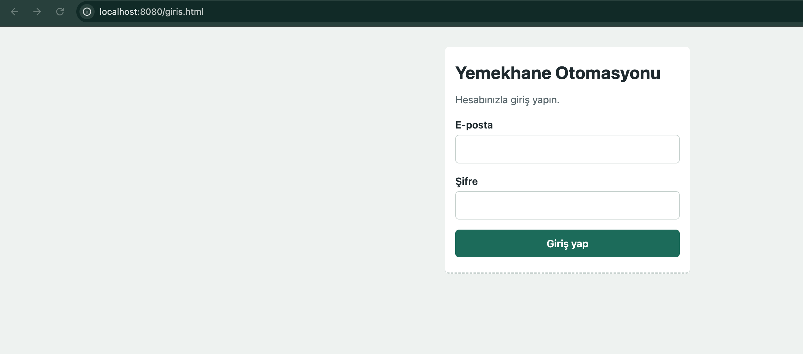
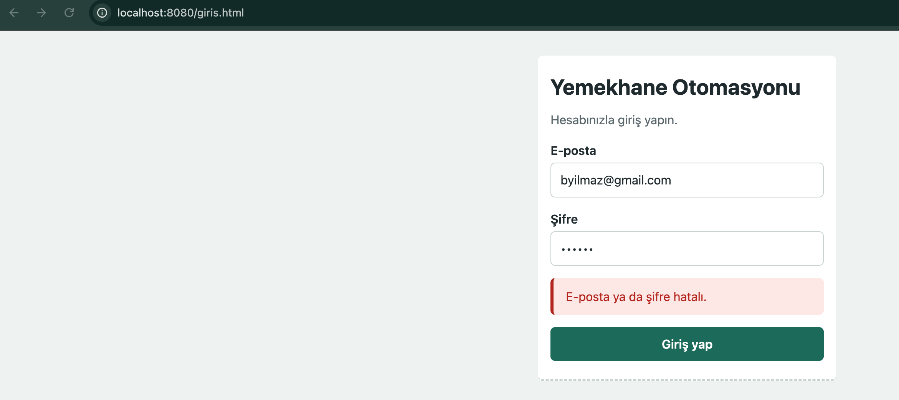
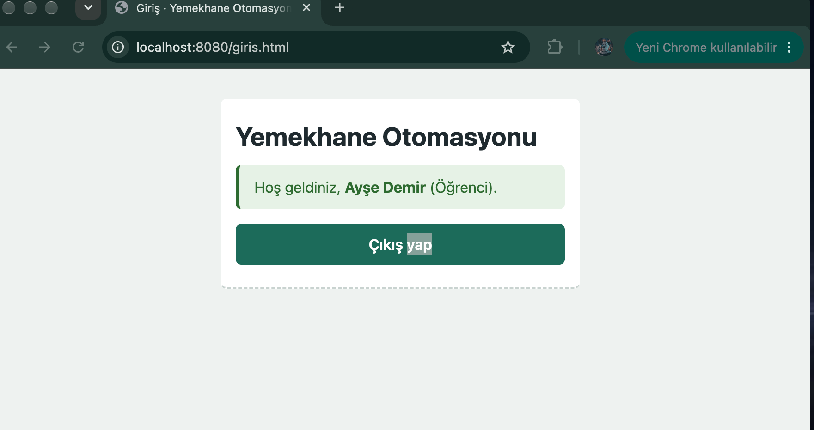

 # Aşama 2 · Uygulama

Tarih: 19.11.2026 · Ortam: macOS (Darwin 27.0), Docker 29.8.0, Docker Compose v5.5.1, Node.js 22

## Seçilen yol

**Web API + arayüz.** Uygulama yalnızca JSON döner. HTML5 + CSS3 arayüz `frontend/` klasöründe
durur ve veriyi JavaScript `fetch` ile alır. Apache `/api/` ile başlayan istekleri uygulamaya iletir.
Framework olarak **Node.js + Express 5** kullanıldı.

## 1. Uygulama iskeleti

`uygulama/` klasöründe bir Node projesi oluşturuldu ve Express kuruldu:

```
> npm init -y
> npm install express
```

`package.json` içindeki bağımlılık: `"express": "^5.3.0"`. `package-lock.json` bağımlılık
sürümlerini kilitler; Docker imajı aynı sürümleri kurar.

İlk sürüm `uygulama/index.js`, tek bir uç içerir. Uygulama container içinde 8000 portunu dinler:

```js
const express = require('express');

const app = express();
const PORT = 8000;

app.get('/api/saglik', (req, res) => {
  res.json({ durum: 'ok' });
});

app.listen(PORT, () => {
  console.log(`Uygulama ${PORT} portunda dinliyor`);
});
```

Docker'sız yerel denemede tanımlı uç 200, tanımsız uç 404 döndü:

```
> curl -i http://localhost:8000/api/saglik
HTTP/1.1 200 OK
Content-Type: application/json; charset=utf-8

{"durum":"ok"}

> curl -o /dev/null -w "HTTP %{http_code}\n" http://localhost:8000/api/yok
HTTP 404
```

## 2. Dockerfile

`uygulama/Dockerfile`:

```dockerfile
FROM node:22-alpine

WORKDIR /app

# Önce yalnızca bağımlılık dosyaları: kod değişince npm ci yeniden çalışmasın
COPY package.json package-lock.json ./
RUN npm ci --omit=dev

# Sonra uygulama kodu
COPY . .

EXPOSE 8000

# root yerine node kullanıcısıyla çalış
USER node

CMD ["node", "index.js"]
```

- Bağımlılıklar koddan önce kopyalanır; böylece `index.js` değişince Docker `npm ci` katmanını
  önbellekten kullanır.
- `npm ci`, `package-lock.json`'daki sürümleri birebir kurar.
- `.dockerignore` içinde `node_modules` var: macOS'ta kurulmuş paketler Linux imajına girmez
  (`bcrypt` gibi paketler işletim sistemine özgü derlenir).
- Uygulama `root` yerine yetkisiz `node` kullanıcısıyla çalışır. Geçici imajla yapılan denemede
  `docker exec ... whoami` çıktısı `node` oldu.

## 3. Compose'a uygulama servisi

`docker-compose.yml` içindeki hazır `uygulama:` bloğunun yorum işaretleri kaldırıldı:

```yaml
  uygulama:
    build: ./uygulama
    restart: unless-stopped
    environment:
      <<: *uygulama-ortam
    depends_on:
      mysql-primary:
        condition: service_healthy
      redis:
        condition: service_healthy
      replica-setup:
        condition: service_completed_successfully
```

- `environment`, dosyanın başındaki `x-uygulama-ortam` bloğunu (`DB_YAZMA_HOST`, `DB_OKUMA_HOST`,
  `REDIS_HOST` vb.) uygulamaya aktarır.
- `depends_on`, uygulamanın kaynak veritabanı ve Redis sağlıklı olmadan, replika kurulumu da
  başarıyla bitmeden başlamasını engeller.
- `uygulama` servisine `ports:` verilmedi. 8000 portu yalnızca Docker'ın iç ağında açıktır;
  dışarıdan tek giriş Apache'dir (8080).
- Apache modu için `frontend` servisinde `-D WEBAPI` zaten ayarlıydı. `apache/yemekhane.conf`
  içinde bu mod `/api/` isteklerini `http://uygulama:8000/api/` adresine iletir.

```
> docker compose up -d --build
> docker compose ps -a
SERVICE         STATUS                      PORTS
frontend        Up 2 days (healthy)         0.0.0.0:8080->80/tcp, [::]:8080->80/tcp
mysql-primary   Up 2 days (healthy)         0.0.0.0:3307->3306/tcp, [::]:3307->3306/tcp
mysql-replica   Up 51 minutes (healthy)     0.0.0.0:3308->3306/tcp, [::]:3308->3306/tcp
redis           Up 2 days (healthy)         0.0.0.0:6379->6379/tcp, [::]:6379->6379/tcp
replica-setup   Exited (0) 12 minutes ago
uygulama        Up 12 minutes               8000/tcp
```

Mevcut beş container yeniden oluşturulmadı, veritabanı verileri korundu. `replica-setup`
`uygulama`'nın bağımlılığı olduğu için yeniden çalıştı ve "Replika zaten yapılandırılmış, işlem
yapılmadı" çıktısıyla bitti (betik tekrar çalıştırılabilir).

## 4. Apache üzerinden doğrulama

```
> curl -i http://localhost:8080/api/saglik
HTTP/1.1 200 OK
Server: Apache/2.4.71 (Unix)
X-Powered-By: Express
Content-Type: application/json; charset=utf-8

{"durum":"ok"}
```

`Server: Apache` ve `X-Powered-By: Express` başlıklarının birlikte görünmesi, isteğin Apache'den
geçip Express tarafından yanıtlandığını gösterir.

```
> curl -o /dev/null -w "HTTP %{http_code}\n" http://localhost:8080/
HTTP 200
> curl -m 3 http://localhost:8000/api/saglik
(bağlantı kurulamadı)
```

Ana sayfa Apache'nin `frontend/` klasöründen sunulmaya devam ediyor. Uygulamanın 8000 portuna
dışarıdan ulaşılamıyor; istekler yalnızca Apache üzerinden geliyor.

Uygulama günlüğü:

```
> docker compose logs uygulama
uygulama-1  | Uygulama 8000 portunda dinliyor
```

Ekran görüntüsü: tarayıcıda `http://localhost:8080/api/saglik` adresi.



## 5. Veri katmanı: yazma ve okuma havuzları

`mysql2` sürücüsü kuruldu (`npm install mysql2`, sürüm 3.24.6). `uygulama/veri/baglanti.js`
iki bağlantı havuzu tanımlar; bağlantı bilgileri koda yazılmaz, compose'un verdiği ortam
değişkenlerinden okunur:

```js
const mysql = require('mysql2/promise');

const ortak = {
  port: Number(process.env.DB_PORT),
  database: process.env.DB_ADI,
  user: process.env.DB_KULLANICI,
  password: process.env.DB_SIFRE,
  charset: 'utf8mb4',     // Türkçe karakterler (ş, ğ, ı) bozulmasın
  timezone: '+03:00',     // veritabanı sunucusunun saat dilimiyle aynı
  waitForConnections: true,
  connectionLimit: 10,    // havuzda aynı anda en fazla 10 bağlantı
};

// Yazma işlemleri (INSERT, UPDATE, stored procedure) yalnızca buradan: kaynak sunucu
const yazmaHavuzu = mysql.createPool({ ...ortak, host: process.env.DB_YAZMA_HOST });

// Okuma işlemleri (SELECT, listeleme, rapor) buradan: replika sunucu
const okumaHavuzu = mysql.createPool({ ...ortak, host: process.env.DB_OKUMA_HOST });

module.exports = { yazmaHavuzu, okumaHavuzu };
```

Bundan sonra SQL yalnızca `veri/` klasöründeki dosyalarda yazılır ve bu iki havuzdan birini
kullanır. Okuma/yazma ayrımının doğru çalıştığı, geçici bir doğrulama ucuyla her iki havuza
`SELECT @@server_id, @@read_only` sorularak gösterildi (uç doğrulamadan sonra koddan kaldırıldı):

```
> curl http://localhost:8080/api/db-test
{"yazma":{"server_id":1,"read_only":0},"okuma":{"server_id":2,"read_only":1}}
```

- `yazmaHavuzu` kaynağa (`server_id` 1) bağlanır ve yazmaya açıktır (`read_only` 0).
- `okumaHavuzu` replikaya (`server_id` 2) bağlanır ve salt okunurdur (`read_only` 1).

## 6. Giriş ve çıkış

`bcryptjs` (bcrypt'in saf JavaScript sürümü, derleme gerektirmez, `$2a$` özetleriyle uyumlu) ve
`express-session` kuruldu (`npm install bcryptjs express-session`). Oturum bu aşamada uygulamanın
belleğinde tutulur; Aşama 3'te Redis'e taşınacaktır.

Uygulama katmanlara ayrıldı:

| Klasör | Görevi |
|---|---|
| `rotalar/` | Adresi Controller fonksiyonuna bağlar |
| `ara/` | Ara katman: giriş yapmamış isteği 401 ile durdurur |
| `controllers/` | İş akışı: şifre kontrolü, oturum açma/kapama. SQL içermez |
| `veri/` | SQL yalnızca burada; okuma replikaya, yazma kaynağa |

Uçlar: `POST /api/giris`, `POST /api/cikis`, `GET /api/ben` (yalnızca giriş yapmış kullanıcı).

### Bir isteğin uygulama içindeki yolu: `POST /api/giris`

**1. Route** · `index.js` tüm oturum rotalarını `/api` altına bağlar, `rotalar/oturum.js` adresi
Controller'a yönlendirir:

```js
app.use('/api', oturumRotalari);                 // index.js
router.post('/giris', oturum.giris);             // rotalar/oturum.js
```

**2. Controller** · `controllers/oturumController.js` gelen bilgiyi denetler, kullanıcıyı veri
katmanından ister ve şifreyi bcrypt ile karşılaştırır:

```js
const kullanici = await kullaniciVeri.epostaIleBul(eposta);
const sifreDogru = kullanici !== null && await bcrypt.compare(sifre, kullanici.sifre_hash);
if (!sifreDogru) {
  return res.status(401).json({ hata: 'E-posta ya da şifre hatalı.' });
}
```

**3. Veri katmanı** · `veri/kullaniciVeri.js` SQL'i çalıştırır. Bu bir okuma işlemi olduğu için
replikaya bağlı `okumaHavuzu` kullanılır:

```js
const [satirlar] = await okumaHavuzu.execute(
  `SELECT id, ad, soyad, eposta, sifre_hash, rol, aktif
     FROM kullanicilar
    WHERE eposta = ?`,
  [eposta]
);
```

**4. Yanıt** · Şifre doğruysa oturum kimliği yenilenir (`req.session.regenerate`, session
fixation saldırısına karşı), oturuma yalnızca `id`, `ad`, `soyad`, `rol` yazılır (şifre özeti
yazılmaz) ve tarayıcıya imzalı oturum çerezi gönderilir:

```
Set-Cookie: yemekhane.sid=s%3A...; Path=/; HttpOnly; SameSite=Lax
{"kullanici":{"id":7,"ad":"Mehmet","soyad":"Yıldız","rol":"ogrenci"}}
```

### Güvenlik kararları

- Şifre açık hâliyle hiçbir yerde saklanmaz; `bcrypt.compare` girilen şifreyi kayıtlı özetteki
  tuzla yeniden özetleyip karşılaştırır.
- Yanlış e-posta ile yanlış şifre **aynı** mesajı döndürür; böylece hangi e-postaların sistemde
  kayıtlı olduğu dışarıdan öğrenilemez.
- Çerez `HttpOnly` (sayfadaki JavaScript okuyamaz) ve `SameSite=Lax`'tır (başka sitelerden gelen
  isteklerde gönderilmez). Çerezde kullanıcı bilgisi yoktur, yalnızca imzalı oturum kimliği vardır.
- Çerezi imzalayan anahtar koda yazılmaz; compose'daki `OTURUM_SIRRI` ortam değişkeninden okunur.

### Doğrulama (Apache üzerinden)

```
> curl -s $U/ben
{"hata":"Bu işlem için giriş yapmalısınız."}  -> HTTP 401
> curl -s -d '{"eposta":"mehmet.yildiz@ogr.kampus.edu.tr","sifre":"yanlis"}' $U/giris
{"hata":"E-posta ya da şifre hatalı."}  -> HTTP 401
> curl -s -c /tmp/cerez.txt -d '{"eposta":"mehmet.yildiz@ogr.kampus.edu.tr","sifre":"Yemek2026!"}' $U/giris
{"kullanici":{"id":7,"ad":"Mehmet","soyad":"Yıldız","rol":"ogrenci"}}  -> HTTP 200
> curl -s -b /tmp/cerez.txt $U/ben
{"kullanici":{"id":7,"ad":"Mehmet","soyad":"Yıldız","rol":"ogrenci"}}  -> HTTP 200
> curl -s -b /tmp/cerez.txt -X POST $U/cikis
{"durum":"Çıkış yapıldı."}  -> HTTP 200
> curl -s -b /tmp/cerez.txt $U/ben
{"hata":"Bu işlem için giriş yapmalısınız."}  -> HTTP 401
```

(`U=http://localhost:8080/api`; JSON gönderen komutlarda `-H 'Content-Type: application/json'`
de verildi.) Giriş yapılmadan korumalı uca erişilemiyor, doğru şifreyle oturum açılıyor ve çıkıştan
sonra aynı çerez artık geçersiz.



### Giriş ekranı (`/giris.html`)

Arayüz `frontend/` klasöründe durur, Apache doğrudan sunar; API'ye JavaScript `fetch` ile
bağlanır (React ya da başka çerçeve yok):

| Dosya | Görevi |
|---|---|
| `frontend/giris.html` | E-posta ve şifre formu; giriş yapılmışsa karşılama ve "Çıkış yap" düğmesi |
| `frontend/js/api.js` | Tüm ekranların ortak kullandığı `apiIstek()`: API'ye JSON isteği atar, sonucu `{ok, veri}` ya da `{ok:false, hata}` biçimine çevirir |
| `frontend/js/giris.js` | Sayfanın davranışı |
| `frontend/css/giris.css` | Giriş sayfasına özgü stil (renkler `temel.css`'ten) |

Sayfa açılınca `GET /api/ben` çağrılır: oturum varsa karşılama gösterilir, yoksa form (sayfa
yenilense de oturum çerezi sayesinde giriş korunur). Form gönderilince `POST /api/giris` çağrılır;
hata olursa sunucunun Türkçe mesajı kırmızı kutuda olduğu gibi gösterilir.

Arayüz tarafındaki kararlar:

- **Arayüzde iş kuralı yoktur.** Şifrenin doğru olup olmadığına, kullanıcının aktif olup
  olmadığına sunucu karar verir; arayüz yalnızca dönen mesajı gösterir.
- Kullanıcının adı ve soyadı sayfaya `textContent` ile yazılır, `innerHTML` ile değil; bir ad içine
  HTML ya da betik yazılsa bile çalışmaz (XSS'e karşı).
- İstek sürerken "Giriş yap" düğmesi devre dışı kalır; çift tıklamayla iki istek gitmez.

Boş form:



Hatalı giriş. Burada denenen e-posta (`byilmaz@gmail.com`) veritabanında kayıtlı değildir; kayıtlı
bir e-postayla yanlış şifre girildiğinde de **aynı** mesaj çıkar:



Başarılı giriş (Ayşe Demir, öğrenci hesabı):



Telefon genişliği (yaklaşık 400 px, tarayıcının cihaz simülasyonu): form tek sütunda, yatay
kaydırma çıkmadan kullanılabiliyor:


