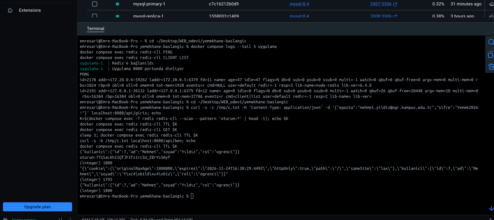
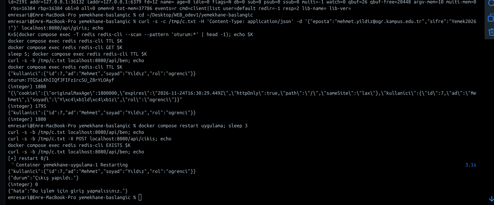

# Aşama 3 · Redis

Tarih: 24.11.2026 · Ortam: macOS (Darwin 27.0), Docker 29.8.0, Docker Compose v5.5.1, Node.js 22, Redis 7.4

Redis iki iş için kullanılır:

| Görev | Anahtar | Süre | Ne zaman silinir |
|---|---|---|---|
| Menü önbelleği | `menu:{yemekhane_id}:{tarih}:{ogun_id}` | o günün sonuna kadar | yönetici o menüyü değiştirdiğinde |
| Oturum | `oturum:{token}` | 30 dakika, her istekte yenilenir | çıkış yapıldığında |

Redis servisi başlangıç paketinde hazırdı (`redis:7.4-alpine`, AOF açık). Uygulama servisi
compose'ta Redis `healthy` olana kadar bekler ve adresi ortam değişkenlerinden alır
(`REDIS_HOST: redis`, `REDIS_PORT: "6379"`).

## 1. Redis bağlantısı

Resmî Node istemcisi kuruldu:

```
> npm install redis@^6
```

`package.json` içindeki bağımlılık: `"redis": "^6.4.0"`. Docker imajı `npm ci` ile kurduğu için
`package-lock.json` da güncellendi.

Uygulamanın tek Redis bağlantısı `uygulama/veri/redis.js` dosyasındadır. Oturum deposu ve
menü önbelleği bu bağlantıyı ortak kullanır:

```js
const { createClient } = require('redis');

const redis = createClient({
  url: `redis://${process.env.REDIS_HOST}:${process.env.REDIS_PORT}`,
});

redis.on('error', (err) => console.error(`Redis hatası: ${err.message}`));
redis.on('ready', () => console.log('Redis\'e bağlanıldı'));

module.exports = redis;
```

`'error'` olayını dinlemek zorunludur: dinleyici yoksa Node, bağlantı hatasında uygulamayı
kapatır. Dinleyici varken hata günlüğe yazılır ve istemci kendiliğinden yeniden bağlanmayı dener.

`uygulama/index.js` önce Redis'e bağlanır, sonra istek kabul etmeye başlar. Böylece Redis
hazır olmadan gelen bir istek oturum ya da önbellek işleminde takılmaz:

```js
async function basla() {
  await redis.connect();
  app.listen(PORT, () => {
    console.log(`Uygulama ${PORT} portunda dinliyor`);
  });
}

basla();
```

Doğrulama: uygulama günlüğünde önce Redis bağlantısı, sonra dinleme satırı görünür.
`redis-cli PING` `PONG` döner. `CLIENT LIST` çıktısındaki `lib-name=node-redis lib-ver=6.4.0`
satırı bizim uygulamamızdır; adresi (`172.20.0.6`) Docker ağının içindendir, yani uygulama
Redis'e dışarıdaki 6379 portundan değil servis adıyla bağlanır.

```
> docker compose logs --tail 5 uygulama
> docker compose exec redis redis-cli PING
> docker compose exec redis redis-cli CLIENT LIST
```


## 2. Oturumun Redis'e taşınması

Aşama 2'de oturumlar uygulamanın belleğindeydi: uygulama container'ı yeniden başlayınca bütün
kullanıcıların girişi düşüyordu. Oturumlar artık Redis'te tutulur. Express'in oturum ara katmanı
(`express-session`) değişmedi, yalnızca deposu değişti:

```
> npm install connect-redis@^9
```

`uygulama/index.js`:

```js
const OTURUM_SURESI_SN = 30 * 60;     // 30 dakika

app.use(session({
  name: 'yemekhane.sid',
  store: new RedisStore({
    client: redis,                    // 1. bölümdeki ortak bağlantı
    prefix: 'oturum:',                // Redis'teki anahtarın öneki
    ttl: OTURUM_SURESI_SN,
  }),
  secret: process.env.OTURUM_SIRRI,
  resave: false,
  saveUninitialized: false,
  rolling: true,
  cookie: {
    httpOnly: true,
    sameSite: 'lax',
    maxAge: OTURUM_SURESI_SN * 1000,
  },
}));
```

Ödevin istediği üç kural bu ayarlarla karşılanır:

| Kural | Nasıl |
|---|---|
| Anahtar `oturum:{token}` | `prefix: 'oturum:'`. Token, tarayıcıdaki çerezin imzasız kısmıdır. |
| 30 dakika, her istekte yenilenir | `ttl` ve çerez ömrü 30 dk. `rolling: true` her yanıtta çerezin ve Redis anahtarının süresini baştan başlatır. `resave: false` olduğu için değişmeyen oturum yeniden yazılmaz, yalnızca süresi uzatılır (`touch` → Redis `EXPIRE`). |
| Çıkışta silinir | `cikis` Controller'ı zaten `req.session.destroy()` çağırıyordu; depo bunu Redis `DEL`'e çevirir. Controller'da değişiklik gerekmedi. |

Tarayıcıya giden çerez yalnızca imzalı bir kimliktir, örneğin
`s%3AGHc9dwIV...Rr.cEwVHl...`: noktadan önceki kısım Redis anahtarındaki token, sonrası
`OTURUM_SIRRI` ile atılmış imzadır. Kullanıcının bilgileri (id, ad, rol) Redis'te durur;
şifre özeti oturuma hiç yazılmaz. `GET` çıktısındaki `Y\xc4\xb1ld\xc4\xb1z`, "Yıldız"
adının UTF-8 baytlarıdır; `redis-cli` ASCII dışı karakterleri bu biçimde gösterir.

**Deneme 1: giriş, anahtar, süre ve yenilenme.** Girişten sonra `oturum:` önekli tek anahtar
oluştu, süresi 1800 sn. 5 sn sonra 1795'e indi; `/api/ben` isteğinden sonra yeniden 1800 oldu.

```
> curl -s -c /tmp/c.txt -H 'Content-Type: application/json' \
    -d '{"eposta":"mehmet.yildiz@ogr.kampus.edu.tr","sifre":"Yemek2026!"}' localhost:8080/api/giris
> K=$(docker compose exec -T redis redis-cli --scan --pattern 'oturum:*' | head -1); echo $K
> docker compose exec redis redis-cli TTL $K
> docker compose exec redis redis-cli GET $K
> sleep 5; docker compose exec redis redis-cli TTL $K
> curl -s -b /tmp/c.txt localhost:8080/api/ben
> docker compose exec redis redis-cli TTL $K
```



**Deneme 2: uygulama yeniden başlatılınca oturum düşmüyor, çıkışta siliniyor.** Uygulama
container'ı yeniden başlatıldıktan sonra aynı çerezle `/api/ben` kullanıcıyı döndürdü. Çıkıştan
sonra `EXISTS` 0 döndü (anahtar silindi) ve `/api/ben` 401 verdi.

```
> docker compose restart uygulama; sleep 3
> curl -s -b /tmp/c.txt localhost:8080/api/ben
> curl -s -b /tmp/c.txt -X POST localhost:8080/api/cikis
> docker compose exec redis redis-cli EXISTS $K
> curl -s -b /tmp/c.txt localhost:8080/api/ben
```



Redis'in kendisi de AOF (`--appendonly yes`) ve `redis-veri` volume'u ile çalışır; Redis
container'ı yeniden başlasa bile oturumlar diskten geri yüklenir.
