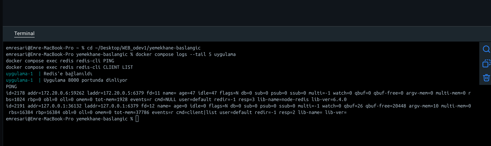
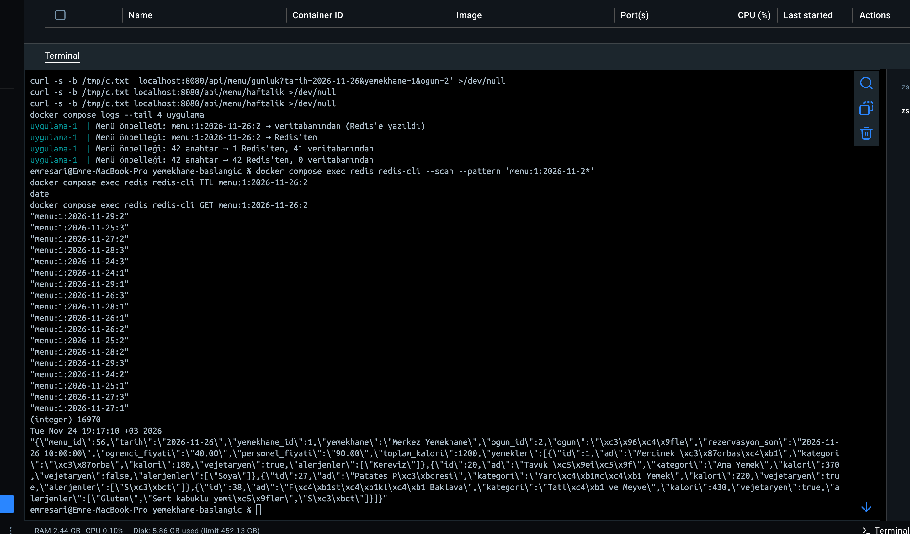

# Aşama 3 · Redis

Tarih: 24.11.2026 · Ortam: macOS (Darwin 27.0), Docker 29.8.0, Docker Compose v5.5.1, Node.js 22, Redis 7.4

Redis iki iş için kullanılır:

| Görev | Anahtar | Süre | Ne zaman silinir |
|---|---|---|---|
| Menü önbelleği | `menu:{yemekhane_id}:{tarih}:{ogun_id}` | o günün sonuna kadar | yönetici o menüyü değiştirdiğinde |
| Oturum | `oturum:{token}` | 30 dakika, her istekte yenilenir | çıkış yapıldığında |

Redis servisi başlangıç paketinde hazırdı (`redis:7.4-alpine`, AOF açık). Uygulama servisi
compose'ta Redis `healthy` olana kadar bekler ve adresi ortam değişkenlerinden alır
(`REDIS_HOST: redis`, `REDIS_PORT: "6379"`).

## 1. Redis bağlantısı

Resmî Node istemcisi kuruldu:

```
> npm install redis@^6
```

`package.json` içindeki bağımlılık: `"redis": "^6.4.0"`. Docker imajı `npm ci` ile kurduğu için
`package-lock.json` da güncellendi.

Uygulamanın tek Redis bağlantısı `uygulama/veri/redis.js` dosyasındadır. Oturum deposu ve
menü önbelleği bu bağlantıyı ortak kullanır:

```js
const { createClient } = require('redis');

const redis = createClient({
  url: `redis://${process.env.REDIS_HOST}:${process.env.REDIS_PORT}`,
});

redis.on('error', (err) => console.error(`Redis hatası: ${err.message}`));
redis.on('ready', () => console.log('Redis\'e bağlanıldı'));

module.exports = redis;
```

`'error'` olayını dinlemek zorunludur: dinleyici yoksa Node, bağlantı hatasında uygulamayı
kapatır. Dinleyici varken hata günlüğe yazılır ve istemci kendiliğinden yeniden bağlanmayı dener.

`uygulama/index.js` önce Redis'e bağlanır, sonra istek kabul etmeye başlar. Böylece Redis
hazır olmadan gelen bir istek oturum ya da önbellek işleminde takılmaz:

```js
async function basla() {
  await redis.connect();
  app.listen(PORT, () => {
    console.log(`Uygulama ${PORT} portunda dinliyor`);
  });
}

basla();
```

Doğrulama: uygulama günlüğünde önce Redis bağlantısı, sonra dinleme satırı görünür.
`redis-cli PING` `PONG` döner. `CLIENT LIST` çıktısındaki `lib-name=node-redis lib-ver=6.4.0`
satırı bizim uygulamamızdır; adresi (`172.20.0.6`) Docker ağının içindendir, yani uygulama
Redis'e dışarıdaki 6379 portundan değil servis adıyla bağlanır.

```
> docker compose logs --tail 5 uygulama
> docker compose exec redis redis-cli PING
> docker compose exec redis redis-cli CLIENT LIST
```



## 2. Oturumun Redis'e taşınması

Aşama 2'de oturumlar uygulamanın belleğindeydi: uygulama container'ı yeniden başlayınca bütün
kullanıcıların girişi düşüyordu. Oturumlar artık Redis'te tutulur. Express'in oturum ara katmanı
(`express-session`) değişmedi, yalnızca deposu değişti:

```
> npm install connect-redis@^9
```

`uygulama/index.js`:

```js
const OTURUM_SURESI_SN = 30 * 60;     // 30 dakika

app.use(session({
  name: 'yemekhane.sid',
  store: new RedisStore({
    client: redis,                    // 1. bölümdeki ortak bağlantı
    prefix: 'oturum:',                // Redis'teki anahtarın öneki
    ttl: OTURUM_SURESI_SN,
  }),
  secret: process.env.OTURUM_SIRRI,
  resave: false,
  saveUninitialized: false,
  rolling: true,
  cookie: {
    httpOnly: true,
    sameSite: 'lax',
    maxAge: OTURUM_SURESI_SN * 1000,
  },
}));
```

Ödevin istediği üç kural bu ayarlarla karşılanır:

| Kural | Nasıl |
|---|---|
| Anahtar `oturum:{token}` | `prefix: 'oturum:'`. Token, tarayıcıdaki çerezin imzasız kısmıdır. |
| 30 dakika, her istekte yenilenir | `ttl` ve çerez ömrü 30 dk. `rolling: true` her yanıtta çerezin ve Redis anahtarının süresini baştan başlatır. `resave: false` olduğu için değişmeyen oturum yeniden yazılmaz, yalnızca süresi uzatılır (`touch` → Redis `EXPIRE`). |
| Çıkışta silinir | `cikis` Controller'ı zaten `req.session.destroy()` çağırıyordu; depo bunu Redis `DEL`'e çevirir. Controller'da değişiklik gerekmedi. |

Tarayıcıya giden çerez yalnızca imzalı bir kimliktir, örneğin
`s%3AGHc9dwIV...Rr.cEwVHl...`: noktadan önceki kısım Redis anahtarındaki token, sonrası
`OTURUM_SIRRI` ile atılmış imzadır. Kullanıcının bilgileri (id, ad, rol) Redis'te durur;
şifre özeti oturuma hiç yazılmaz. `GET` çıktısındaki `Y\xc4\xb1ld\xc4\xb1z`, "Yıldız"
adının UTF-8 baytlarıdır; `redis-cli` ASCII dışı karakterleri bu biçimde gösterir.

**Deneme 1: giriş, anahtar, süre ve yenilenme.** Girişten sonra `oturum:` önekli tek anahtar
oluştu, süresi 1800 sn. 5 sn sonra 1795'e indi; `/api/ben` isteğinden sonra yeniden 1800 oldu.

```
> curl -s -c /tmp/c.txt -H 'Content-Type: application/json' \
    -d '{"eposta":"mehmet.yildiz@ogr.kampus.edu.tr","sifre":"Yemek2026!"}' localhost:8080/api/giris
> K=$(docker compose exec -T redis redis-cli --scan --pattern 'oturum:*' | head -1); echo $K
> docker compose exec redis redis-cli TTL $K
> docker compose exec redis redis-cli GET $K
> sleep 5; docker compose exec redis redis-cli TTL $K
> curl -s -b /tmp/c.txt localhost:8080/api/ben
> docker compose exec redis redis-cli TTL $K
```


**Deneme 2: uygulama yeniden başlatılınca oturum düşmüyor, çıkışta siliniyor.** Uygulama
container'ı yeniden başlatıldıktan sonra aynı çerezle `/api/ben` kullanıcıyı döndürdü. Çıkıştan
sonra `EXISTS` 0 döndü (anahtar silindi) ve `/api/ben` 401 verdi.

```
> docker compose restart uygulama; sleep 3
> curl -s -b /tmp/c.txt localhost:8080/api/ben
> curl -s -b /tmp/c.txt -X POST localhost:8080/api/cikis
> docker compose exec redis redis-cli EXISTS $K
> curl -s -b /tmp/c.txt localhost:8080/api/ben
```


Redis'in kendisi de AOF (`--appendonly yes`) ve `redis-veri` volume'u ile çalışır; Redis
container'ı yeniden başlasa bile oturumlar diskten geri yüklenir.

## 3. Menü önbelleği

### Önbelleğe ne girer, ne girmez?

Aşama 2'deki menü sorgusu üç tür veriyi tek seferde getiriyordu. Hepsi önbelleğe giremez:

| Veri | Önbellekte mi? | Neden |
|---|---|---|
| Menü içeriği: yemekler, kalori, alerjenler, iki fiyat, rezervasyon son saati | **Evet** | Herkes için aynı, yalnızca yönetici değiştirince değişir. |
| Boş yer (`bos_yer`), kapasite | Hayır | Her rezervasyon ve iptalde değişir. Önbelleğe girseydi her rezervasyonda kaydı silmek gerekirdi. |
| `rezervasyonum` (bu menüde rezervasyonum var mı?) | Hayır | Kişiye özeldir. Önbelleğe girseydi bir öğrencinin "Rezervasyonunuz var" yazısı herkese görünürdü. |

Bu yüzden sorgu ikiye ayrıldı: içerik Redis'ten, anlık bilgiler her istekte küçük bir sorguyla
replikadan gelir. Rolüne göre fiyat seçimi (öğrenci / personel) önbellekten sonra Controller'da
yapılır; önbellekte iki fiyat da durur ama arayüze yalnızca biri gider.

### Kod

Redis'le ilgili bütün menü kodu `uygulama/veri/menuOnbellek.js` dosyasındadır:

```js
function anahtar(yemekhaneId, tarih, ogunId) {
  return `menu:${yemekhaneId}:${tarih}:${ogunId}`;
}

// Anahtarları tek istekte (MGET) okur. Önbellekte olmayan anahtar Map'e girmez.
async function oku(anahtarlar) {
  const degerler = anahtarlar.length ? await redis.mGet(anahtarlar) : [];
  const bulunanlar = new Map();
  anahtarlar.forEach((a, i) => {
    if (degerler[i] !== null) bulunanlar.set(a, JSON.parse(degerler[i]));
  });
  return bulunanlar;
}

// Okuyan istek önbelleği yalnızca anahtar BOŞSA doldurur (SET NX).
// silinmeZamani: bugün gece yarısı (Unix saniyesi) → EXAT ile o anda Redis kendisi siler.
async function bosaYaz(anahtar, icerik, silinmeZamani) {
  await redis.set(anahtar, JSON.stringify(icerik), {
    condition: 'NX',
    expiration: { type: 'EXAT', value: silinmeZamani },
  });
}
```

`uygulama/veri/menuVeri.js` içindeki `menulerGetir` dört adımda çalışır (Controller değişmedi):

```js
async function menulerGetir({ kullaniciId, baslangic, gunSayisi = 1, yemekhaneId = null, ogunId = null }) {
  // 1. Bu istek hangi anahtarlara bakmalı? (gün × yemekhane × öğün, sıralı)
  const anahtarlar = await anahtarlariHazirla({ baslangic, gunSayisi, yemekhaneId, ogunId });

  // 2. Önce Redis'e sor
  const icerikler = await menuOnbellek.oku(anahtarlar);
  const eksikler = anahtarlar.filter((a) => !icerikler.has(a));

  // 3. Önbellekte olmayanları replikadan getir ve önbelleğe yaz (bugün gece yarısına kadar)
  if (eksikler.length) {
    const [veritabanindan, gunSonu] = await Promise.all([
      menuIcerikleriGetir(okumaHavuzu, { baslangic, gunSayisi, yemekhaneId, ogunId }),
      gunSonuZamani(),
    ]);
    await Promise.all(eksikler.map((a) => {
      const icerik = veritabanindan.get(a) ?? null;   // null = o gün o öğünde menü yok
      icerikler.set(a, icerik);
      return menuOnbellek.bosaYaz(a, icerik, gunSonu);
    }));
  }
  menuOnbellek.gunlugeYaz(anahtarlar, eksikler);

  // 4. Anlık bilgileri ekle
  const menuler = anahtarlar.map((a) => icerikler.get(a)).filter((m) => m !== null);
  const anlik = await anlikBilgileriGetir(kullaniciId, menuler.map((m) => m.menu_id));
  return menuler.map((m) => ({ ...m, ...anlik.get(m.menu_id) }));
}
```

Ayrıntılar:

- **Süre: o günün sonuna kadar.** Gece yarısı veritabanının saatinden alınır
  (`UNIX_TIMESTAMP(CURDATE() + INTERVAL 1 DAY)`) ve `EXAT` ile verilir; Redis kaydı o anda
  kendisi siler. Ertesi gün ilk istek menüleri yeniden veritabanından okur. "Bugün" ve
  "son saat geçti mi" kararları da veritabanı saatiyle verildiği için iki saat çelişmez.
- **Menüsü olmayan gün de önbelleğe girer** (değer `null`). Böylece boş günler her istekte
  veritabanına sorulmaz. Yönetici o güne menü eklerse bu kayıt da silinir (4. bölüm).
- **Haftalık menü** 7 gün × 2 yemekhane × 3 öğün = 42 anahtardır ve tek `MGET` isteğiyle okunur.
- **`SET NX`:** okuyan istek yalnızca boş anahtarı doldurur. Nedeni 4. bölümde:
  yöneticinin kaynaktan yazdığı yeni menünün üzerine, replikadan eski menüyü okumuş bir istek
  yazamamalıdır.
- `uq_menu (yemekhane_id, tarih, ogun_id)` kısıtı sayesinde her anahtara en fazla bir menü düşer.

### Doğrulama

**Yanıtlar değişmedi.** Değişiklikten önce beş istek (günün menüsü, süzgeçli günün menüsü, iki
haftalık menü, menüsüz bir gün) kaydedildi; yeni kodla hem önbellek boşken hem doluyken aynı
istekler gönderildi. On yanıtın hepsi eskisiyle bayt bayt aynı çıktı.

**Anlık bilgiler önbellekten etkilenmiyor.** 28 Kasım öğle menüsü Redis'teyken rezervasyon
yapıldı: menü Redis'ten geldiği hâlde `bos_yer` 394 → 393 ve `rezervasyonum` `true` oldu; iptalden
sonra ikisi de eski hâline döndü.

**İlk istek veritabanından, ikincisi Redis'ten.** Önbellek boşaltıldı, aynı istekler ikişer kez
gönderildi. İlk haftalık istekte "1 Redis'ten" görünür: 26 Kasım öğle menüsü bir önceki istekte
önbelleğe yazılmıştı.

```
> docker compose exec redis sh -c "redis-cli --scan --pattern 'menu:*' | xargs -r redis-cli DEL"
> curl -s -c /tmp/c.txt -H 'Content-Type: application/json' \
    -d '{"eposta":"mehmet.yildiz@ogr.kampus.edu.tr","sifre":"Yemek2026!"}' localhost:8080/api/giris >/dev/null
> curl -s -b /tmp/c.txt 'localhost:8080/api/menu/gunluk?tarih=2026-11-26&yemekhane=1&ogun=2' >/dev/null
> curl -s -b /tmp/c.txt 'localhost:8080/api/menu/gunluk?tarih=2026-11-26&yemekhane=1&ogun=2' >/dev/null
> curl -s -b /tmp/c.txt localhost:8080/api/menu/haftalik >/dev/null
> curl -s -b /tmp/c.txt localhost:8080/api/menu/haftalik >/dev/null
> docker compose logs --tail 4 uygulama
```


**Redis'teki kayıt.** Anahtarlar `menu:{yemekhane_id}:{tarih}:{ogun_id}` biçimindedir. `TTL`
16970 sn, `date` çıktısındaki 19:17:10'dan gece yarısına kalan süreye (4 sa 42 dk 50 sn) eşittir.
Değerde yalnızca menü içeriği vardır; `bos_yer` ve `rezervasyonum` yoktur. (`\xc3\x96`
gibi diziler Türkçe harflerin UTF-8 baytlarıdır; `redis-cli` böyle gösterir.)

```
> docker compose exec redis redis-cli --scan --pattern 'menu:1:2026-11-2*'
> docker compose exec redis redis-cli TTL menu:1:2026-11-26:2
> date
> docker compose exec redis redis-cli GET menu:1:2026-11-26:2
```


