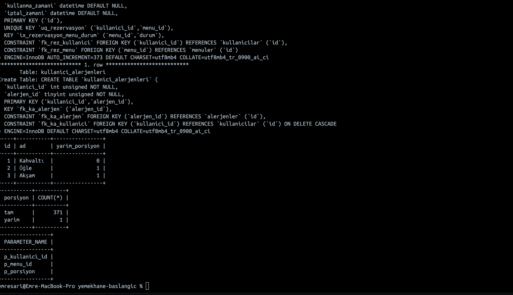
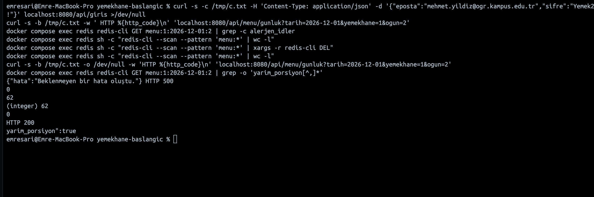
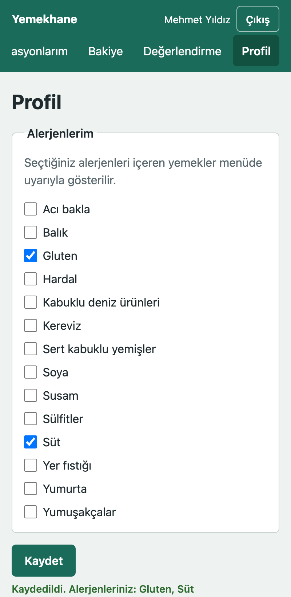
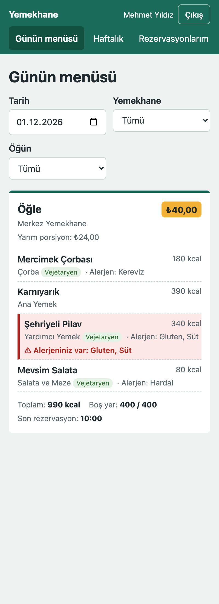
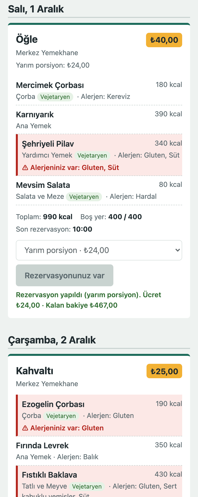
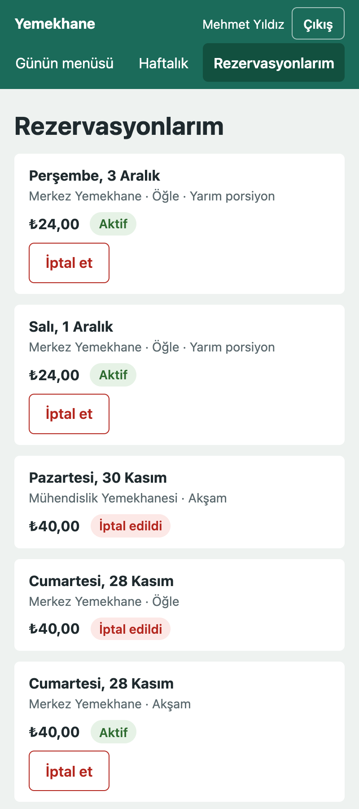

# Aşama 4 · Değişiklik talebi

Tarih: 24.11.2026 · Ortam: macOS (Darwin 27.0), Docker 29.8.0, Docker Compose v5.5.1, Node.js 22, MySQL 8.4, Redis 7.4

Yemekhane Müdürlüğü sistem çalışırken iki yeni özellik istedi:

- **Yarım porsiyon:** öğle ve akşam menülerinde yarım porsiyon seçilebilir, ücret tam fiyatın
  %60'ıdır. Kahvaltıda yarım porsiyon yoktur. Geçmiş rezervasyonlar tam porsiyon sayılır.
- **Alerjen uyarısı:** kullanıcı profilinde alerjenlerini seçer; menüde bu alerjenleri içeren
  yemekler uyarıyla gösterilir.

## 1. Migration: `db/init/04_degisiklik.sql`

Tek dosyadır ve kaynakta (mysql-primary) çalışır. Yaptıkları:

| Değişiklik | Neden |
|---|---|
| `ogunler.yarim_porsiyon TINYINT(1) DEFAULT 1`, kahvaltı için `0` | "Kahvaltıda yarım porsiyon yok" kuralı **veride** durur. Kod "öğün 1 kahvaltıdır" diye bir varsayım yapmaz; yarın akşam yemeğinde de kaldırılırsa yalnızca bir `UPDATE` yeter. |
| `rezervasyonlar.porsiyon ENUM('tam','yarim') NOT NULL DEFAULT 'tam'` | `DEFAULT 'tam'` sayesinde **mevcut bütün rezervasyonlar tam porsiyon** olur. Ödenen ücretleri zaten tam fiyattır; hiçbir satır güncellenmez. |
| Yeni tablo `kullanici_alerjenleri (kullanici_id, alerjen_id)` | Bir kullanıcı birden çok alerjen seçer (çoka çok). Birincil anahtar aynı alerjenin iki kez eklenmesini engeller; kullanıcı silinirse satırları da silinir (`ON DELETE CASCADE`). |
| `sp_rezervasyon_yap` güncellendi: üçüncü parametre `p_porsiyon` | Yarım porsiyonun ücreti ve kahvaltı yasağı, diğer kurallar gibi **yordamın transaction'ı içinde**. Değişen satırlar dosyada `AŞAMA 4` ile işaretli. |

Yordamın yeni kısımları:

```sql
-- porsiyon değeri denetimi
IF p_porsiyon IS NULL OR p_porsiyon NOT IN ('tam', 'yarim') THEN
    SIGNAL SQLSTATE '45000' SET MESSAGE_TEXT = 'Geçersiz porsiyon.';
END IF;
...
-- kahvaltıda yarım porsiyon yok (o.yarim_porsiyon menü satırıyla birlikte, kilitli okunur)
IF p_porsiyon = 'yarim' AND v_yarim_var = 0 THEN
    SIGNAL SQLSTATE '45000' SET MESSAGE_TEXT = 'Bu öğünde yarım porsiyon yoktur.';
END IF;
...
-- yarım porsiyon tam fiyatın %60'ı (kuruşa yuvarlanır)
SET v_ucret = IF(v_rol = 'ogrenci', v_ogr_fiyat, v_per_fiyat);
IF p_porsiyon = 'yarim' THEN
    SET v_ucret = ROUND(v_ucret * 0.60, 2);
END IF;
```

Yarım porsiyon da kapasiteden bir kişilik yer düşer (bir kişi bir koltuk). Rezervasyon iptali
(`sp_rezervasyon_iptal`) değişmedi: iade, rezervasyonda saklanan `ucret` kadardır, yani yarım
porsiyonun iadesi de doğru tutardır.

### Mevcut veriyi bozmadan

- Dosya önce **geçici bir kopya veritabanında** (`yemekhane_test`, `SET sql_log_bin=0` ile;
  replikaya gitmedi) 01 + 02 + 04 sırasıyla çalıştırılıp denendi, sonra silindi. Neden: `ALTER
  TABLE ... ADD COLUMN` iki kez çalıştırılamaz; dosya yarıda kalsaydı asıl veritabanını
  temizlemek zor olurdu.
- Denemede: 367 eski rezervasyonun hepsi `tam`; 40 TL'lik öğle menüsünde yarım porsiyon
  24,00 TL; kahvaltıda yarım porsiyon ve `'buyuk'` gibi geçersiz değer reddedildi.

### Çalıştırma

```
> docker compose exec -T mysql-primary mysql -uroot -pyemekhane_kok yemekhane < db/init/04_degisiklik.sql
```

Sıfırdan kurulumda (`docker compose down -v` + `docker compose up -d`) dosya `db/init/`
klasöründe olduğu için MySQL'in ilk açılış betikleri arasında 01 ve 02'den sonra kendiliğinden
çalışır; ek adım gerekmez.

Bu, çalışan sistemin verisine dokunmadan ayrı bir container'da denendi (`mysql:8.4`, port yok,
`db/init` bağlı). Günlükte `01_sema.sql`, `02_ornek_veri.sql`, `04_degisiklik.sql` sırasıyla
çalıştı; kahvaltı `yarim_porsiyon = 0`, 367 örnek rezervasyonun hepsi `tam`,
`kullanici_alerjenleri` tablosu ve 3 parametreli yordam yerindeydi. Container sonra silindi.

## 2. Değişikliğin replikaya geçmesi

Migration yalnızca kaynakta çalıştırıldı. DDL komutları (`ALTER`, `CREATE TABLE`,
`CREATE PROCEDURE`) binlog'a yazılır ve replika onları GTID replikasyonuyla kendisi uygular.
Kanıt replikadan alınmıştır:

```
> docker compose exec mysql-replica mysql --default-character-set=utf8mb4 -uroot -pyemekhane_kok yemekhane \
    -e "SHOW CREATE TABLE rezervasyonlar\G SHOW CREATE TABLE kullanici_alerjenleri\G
        SELECT id, ad, yarim_porsiyon FROM ogunler; SELECT porsiyon, COUNT(*) FROM rezervasyonlar GROUP BY porsiyon;
        SELECT PARAMETER_NAME FROM information_schema.PARAMETERS WHERE SPECIFIC_NAME='sp_rezervasyon_yap';"
```

Replikadaki `rezervasyonlar` tablosu (`porsiyon` sütunu):

```
Create Table: CREATE TABLE `rezervasyonlar` (
  `id` int unsigned NOT NULL AUTO_INCREMENT,
  `kullanici_id` int unsigned NOT NULL,
  `menu_id` int unsigned NOT NULL,
  `durum` enum('aktif','kullanildi','iptal') CHARACTER SET utf8mb4 COLLATE utf8mb4_tr_0900_ai_ci NOT NULL DEFAULT 'aktif',
  `porsiyon` enum('tam','yarim') COLLATE utf8mb4_tr_0900_ai_ci NOT NULL DEFAULT 'tam',
  `ucret` decimal(8,2) NOT NULL,
  ...
```

Replikadaki `ogunler` tablosu:

```
  `yarim_porsiyon` tinyint(1) NOT NULL DEFAULT '1' COMMENT '1: yarım porsiyon seçilebilir',
```

`kullanici_alerjenleri` tablosu, öğünlerin `yarim_porsiyon` değerleri (kahvaltı 0), porsiyon
sayımları (371 eski rezervasyon `tam`) ve yordamın üç parametresi replikada:



## 3. Redis'te eski yapıdaki menü kayıtlarının temizlenmesi

Menü içeriği (Aşama 3) Redis'te JSON olarak durur. Aşama 4'te içeriğe iki alan eklendi:
menünün `yarim_porsiyon` bilgisi ve her yemeğin `alerjen_idler` listesi. Migration'dan önce
önbelleğe yazılmış kayıtlarda bu alanlar yoktur ve kendiliğinden ancak gece yarısı silinirler.

Yeni uygulama eski kaydı okuduğunda `alerjen_idler` olmadığı için menü isteği **500** verdi.
Temizlik:

```
> docker compose exec redis sh -c "redis-cli --scan --pattern 'menu:*' | xargs -r redis-cli DEL"
```

- `--scan` anahtarları parça parça gezer; `KEYS` gibi Redis'i bütün anahtarlar bitene kadar
  bekletmez.
- Yalnızca `menu:*` silinir; `oturum:*` anahtarlarına dokunulmaz, kimsenin girişi düşmez.
- Temizlikten sonraki ilk istek menüyü veritabanından yeni yapıyla okuyup önbelleğe yazar.

Görüntüde sırasıyla: eski kayıtla `HTTP 500`, eski kayıtta `alerjen_idler` yok (`0`), 62 menü
anahtarı, `DEL` ile 62'sinin silinmesi, kalan `0`, ardından `HTTP 200` ve yeni kayıtta
`yarim_porsiyon`.

```
> curl -s -b /tmp/c.txt -w ' HTTP %{http_code}\n' 'localhost:8080/api/menu/gunluk?tarih=2026-12-01&yemekhane=1&ogun=2'
> docker compose exec redis redis-cli GET menu:1:2026-12-01:2 | grep -c alerjen_idler
> docker compose exec redis sh -c "redis-cli --scan --pattern 'menu:*' | wc -l"
> docker compose exec redis sh -c "redis-cli --scan --pattern 'menu:*' | xargs -r redis-cli DEL"
> docker compose exec redis sh -c "redis-cli --scan --pattern 'menu:*' | wc -l"
> curl -s -b /tmp/c.txt -o /dev/null -w 'HTTP %{http_code}\n' 'localhost:8080/api/menu/gunluk?tarih=2026-12-01&yemekhane=1&ogun=2'
> docker compose exec redis redis-cli GET menu:1:2026-12-01:2 | grep -o 'yarim_porsiyon[^,]*'
```



**Doğru sıra:** (1) migration kaynakta, (2) yeni uygulama, (3) Redis temizliği. Temizlik
uygulamadan önce yapılsaydı, eski uygulama arada gelen isteklerle önbelleği yine eski yapıyla
doldurabilirdi.

## 4. Uygulama

### Yarım porsiyon

| Katman | Değişiklik |
|---|---|
| `veri/rezervasyonVeri.js` | `CALL sp_rezervasyon_yap(?, ?, ?)`; listeye `r.porsiyon` eklendi |
| `controllers/rezervasyonController.js` | Gövdeden `porsiyon` (yoksa `'tam'`); yalnızca biçim denetimi (`'tam'` / `'yarim'`), kural yordamda |
| `veri/menuVeri.js` | Menü içeriğine `ogunler.yarim_porsiyon` |
| `controllers/menuController.js` | `yarim_fiyat`: rolüne göre seçilmiş fiyatın %60'ı, yalnızca yarım porsiyonu olan öğünde (kahvaltıda `null`) |

Arayüzdeki yarım porsiyon fiyatı yalnızca gösterimdir; asıl ücreti yordam hesaplar ve rezervasyon
sonrası mesajda gösterilen ücret yordamın döndürdüğü değerdir. İki hesap aynı kuralı kullanır
(`ROUND(fiyat * 0.60, 2)`); JavaScript'te kayan nokta hatası olmasın diye kuruş üzerinden
tamsayıyla hesaplanır:

```js
function yarimPorsiyonFiyati(fiyat) {
  const kurus = Math.round(Number(fiyat) * 100);
  return (Math.round((kurus * 6) / 10) / 100).toFixed(2);
}
```

API denemeleri (öğrenci Mehmet Yıldız):

| İstek | Yanıt |
|---|---|
| `{"menu_id":90,"porsiyon":"yarim"}` (öğle, 40 TL) | 201 · `ucret: "24.00"`, `porsiyon: "yarim"` |
| `{"menu_id":88,"porsiyon":"yarim"}` (kahvaltı) | 409 · `Bu öğünde yarım porsiyon yoktur.` (yordamın mesajı) |
| `{"menu_id":88,"porsiyon":"buyuk"}` | 400 · `Geçersiz porsiyon.` (Controller) |

### Alerjen uyarısı

| Katman | Değişiklik |
|---|---|
| `veri/profilVeri.js` (yeni) | Bütün alerjenler; kullanıcının alerjenleri; kaydetme (sil + ekle, tek transaction, kaynakta) |
| `controllers/profilController.js`, `rotalar/profil.js` (yeni) | `GET /api/profil`, `PUT /api/profil/alerjenler` (`{"alerjenler":[1,7]}`) |
| `controllers/oturumController.js` | Girişte kullanıcının alerjenleri oturuma yazılır |
| `controllers/menuController.js` | Her yemeğe `uyari`: yemeğin alerjenlerinden kullanıcının seçtikleri |

Kararlar:

- **Kullanıcının alerjenleri oturumda (Redis) tutulur.** Menü her açıldığında veritabanına bir
  sorgu daha gitmez. Profil kaydedilince oturum hemen güncellenir.
- **Kaydedilen liste kaynaktan okunup oturuma yazılır.** Replikadan okunsaydı, replika
  değişikliği henüz almamışsa menüde eski uyarılar görünürdü (Aşama 2'deki bakiye ile aynı
  replikasyon gecikmesi nedeni).
- **Uyarı kararı sunucuda.** Arayüz yalnızca `uyari` listesi boş değilse kırmızı kutuyu çizer.
  `alerjen_idler` arayüze gönderilmez.
- Olmayan bir alerjen kimliği (`[1, 99]`) → `ER_NO_REFERENCED_ROW_2` veri katmanında yakalanır →
  400 `Seçilen alerjenlerden biri bulunamadı.` Transaction geri alındığı için eski seçim korunur.

### Ortak kod

`transactionIcinde` (Aşama 2'de yönetim panelinde yazılmıştı) `veri/baglanti.js`'e taşındı;
yönetim ve profil aynı fonksiyonu kullanır.

## 5. Arayüz

Yeni sayfa `profil.html` (+ `js/profil.js`), gezinme çubuğuna "Profil" bağlantısı. Değişen dosyalar:
`js/menuKarti.js` (yarım porsiyon fiyatı, alerjen uyarısı), `js/haftalik.js` (porsiyon seçimi),
`js/rezervasyonlarim.js` (porsiyon), `css/sayfa.css`. Görüntüler telefon genişliğindedir (400 px)
ve hiçbirinde yana taşma yoktur (sayfa genişliği 400 px ölçüldü).

**Profil: alerjen seçimi.** Gluten ve Süt seçilip kaydedildi.



**Menüde uyarı ve yarım porsiyon fiyatı.** 1 Aralık öğle menüsü: Şehriyeli Pilav (Gluten, Süt)
kırmızı kutuyla işaretli; kartta "Yarım porsiyon: ₺24,00".



**Rezervasyonda porsiyon seçimi.** Haftalık sayfada öğle menüsünde "Yarım porsiyon · ₺24,00"
seçilip rezervasyon yapıldı; mesajdaki ücret yordamın döndürdüğü değerdir. Kahvaltı kartında
porsiyon seçimi yoktur (sunucu `yarim_porsiyon: false` gönderir).



**Rezervasyonlarım.** Yarım porsiyon rezervasyonlar "Yarım porsiyon" yazısıyla ve ödenen
ücretle (₺24,00) görünür; Aşama 4'ten önceki rezervasyonlar tam porsiyon olarak kalır.


