<div class="kapak">

# Yemekhane Otomasyonu · Dönem Ödevi Raporu

<p class="kapak-kisi">Mehmet Emre Sarı · 241229081</p>

**Depo:** github.com/eemresari/YemekhaneSistemi · **Etiketler:** `asama-1` … `asama-4` ·
**Çalıştırma:** `docker compose up -d` (ek adım yok), `http://localhost:8080` · **Tarih:** 24.11.2026

<div class="secilen-yol">

**Seçilen yol: Web API + HTML/CSS arayüz.** Uygulama (Node.js + Express 5) yalnızca JSON döner;
arayüz `frontend/` klasöründe, veriyi `fetch` ile alır. Apache `-D WEBAPI` modunda `/api/`
isteklerini uygulamaya iletir. Katmanlar: `rotalar/` → `controllers/` (SQL yok) → `veri/` (SQL
yalnızca burada; **okuma replikaya, yazma kaynağa**). İş kuralları stored procedure'lerde.

</div>
</div>

# Aşama 1 · Altyapı

```
> docker compose ps -a        → frontend, mysql-primary, mysql-replica, redis: healthy · replica-setup: Exited (0)
> SHOW REPLICA STATUS\G       → Replica_IO_Running: Yes · Replica_SQL_Running: Yes · Seconds_Behind_Source: 0
> kaynakta  CALL sp_bakiye_yukle(7, 100)   → replikada bakiye 355,00 → 455,00
> replikada CALL sp_bakiye_yukle(7, 50)    → ERROR 1290 (HY000): ... running with the --super-read-only option
> stop mysql-replica → kaynakta 200 TL → start mysql-replica  → replika aradakini binlog'dan aldı: 655,00
> redis-cli ping                           → PONG
```

<figure>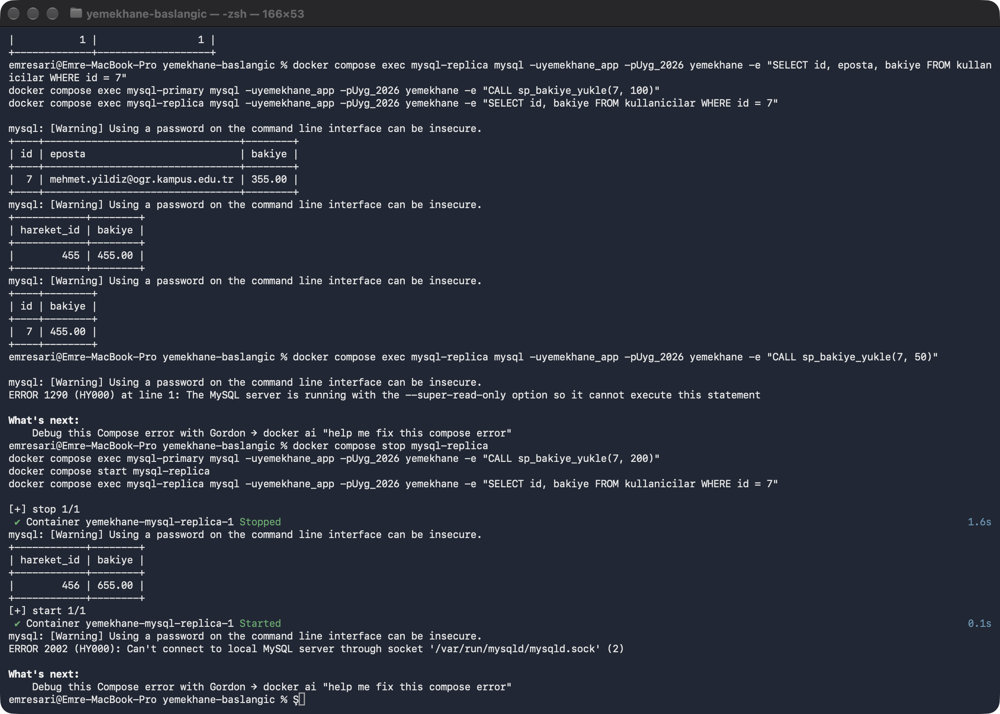<figcaption>Kaynakta yazma, replikaya yazma reddi, replika durdur-başlat (alttaki ERROR 2002: replika henüz bağlantı kabul etmiyordu; tekrarda 655,00)</figcaption></figure>

# Aşama 2 · Uygulama

**Okuma/yazma ayrımı.** `veri/baglanti.js` iki havuz tanımlar: `yazmaHavuzu` → mysql-primary,
`okumaHavuzu` → mysql-replica (adresler ortam değişkenlerinden). Doğrulama:
`{"yazma":{"server_id":1,"read_only":0},"okuma":{"server_id":2,"read_only":1}}`. Uygulamanın 8000
portu dışarıya kapalı, tek kapı Apache (`Server: Apache` + `X-Powered-By: Express`).

**Bir isteğin yolu ve stored procedure** (`POST /api/rezervasyonlar`): route → Controller (kullanıcı
kimliği **oturumdan**, kural yok) → `veri/` (`CALL sp_rezervasyon_yap(?, ?, ?)`, yazma havuzu) →
yordam (süre, kapasite, bakiye, `FOR UPDATE`, tek transaction). Kural çiğnenirse
`SIGNAL SQLSTATE '45000'`; `index.js` hata katmanı bunu **409 + yordamın mesajı** olarak arayüze iletir.

```
yarın öğle                {"rezervasyon_id":368,"ucret":"40.00","bakiye":"315.00"}  → 201
aynı menü ikinci kez      {"hata":"Bu menü için zaten rezervasyonunuz var."}       → 409
bakiye 12,50, 25 TL menü  {"hata":"Bakiye yetersiz."}                             → 409
giriş yok / öğrenci yönetimde   → 401 / 403        bozuk girdi → 400        kaynak kapalı → 503
```

**Rezervasyondan sonraki bakiye neden kaynaktan okunur?** Replika değişiklikleri asenkron alır:
kaynak commit ettiğini binlog'a yazar, replika çeker, relay günlüğüne yazar ve uygular. Bu genellikle
milisaniyeler sürer ama sıfır değildir; yük ya da ağ gecikmesinde saniyelere çıkabilir. Bakiyeyi
rezervasyondan hemen sonra replikadan okusaydık kullanıcı ücret düşülmemiş eski bakiyeyi görür,
işlemi tekrarlayabilirdi. Bu yüzden yordam yeni bakiyeyi kendi transaction'ında, kaynakta hesaplayıp
döndürür; arayüz bunu gösterir ve listeyi replikadan yeniden çekmez. Listeleme ve raporlar replikaya
gider. (Kaynak durdurulup başlatıldığında replika ~1 dakika 465,00, kaynak 515,00 TL gösterdi.)

**Yedi ekran:** giriş, günün menüsü, haftalık menü + rezervasyon, rezervasyonlarım + iptal, bakiye,
değerlendirme, yönetici paneli. Arayüzde iş kuralı yok (fiyat, "rezervasyon açık mı", "iptal
edilebilir mi" sunucudan); metinler `textContent` ile; şifre bcrypt. Telefon (400 px): tek kırılma
noktası, her sayfada `scrollWidth` = 400 px.

<div class="ikili">
<figure>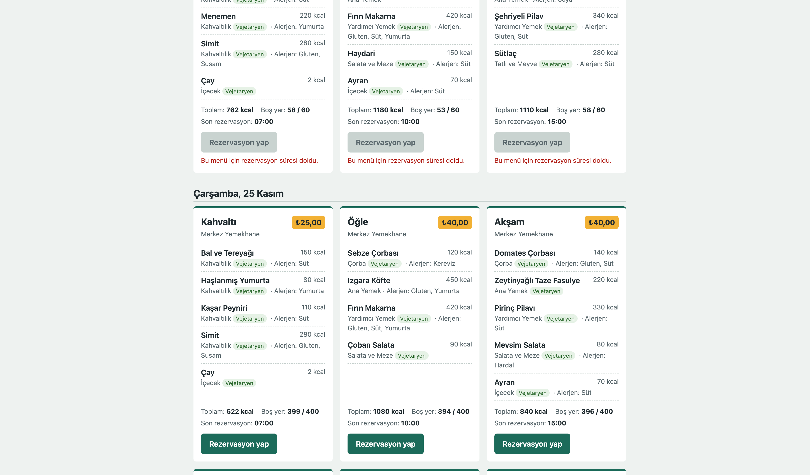<figcaption>Haftalık menü: süresi dolanlarda düğme pasif, neden sunucudan</figcaption></figure>
<figure>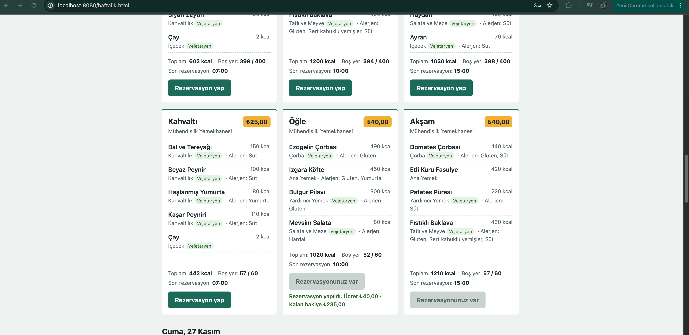<figcaption>Rezervasyon: ücret ve kaynaktan gelen bakiye</figcaption></figure>
</div>

<div class="ikili">
<figure>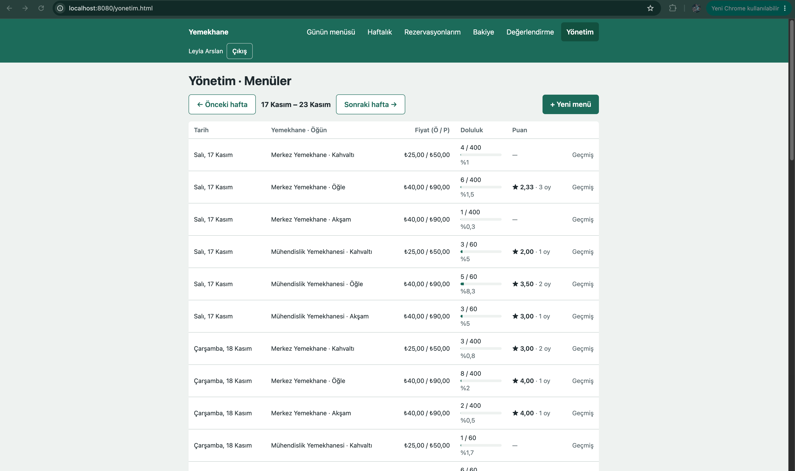<figcaption>Yönetici paneli: fiyat, doluluk, ortalama puan</figcaption></figure>
<figure>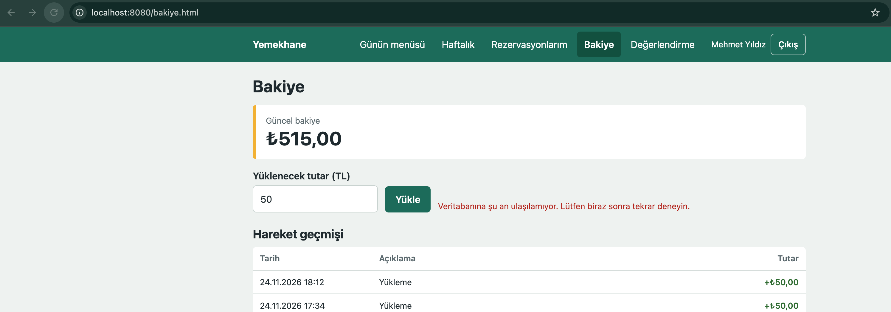<figcaption>Kaynak kapalı: yükleme 503, okumalar replikadan sürüyor</figcaption></figure>
</div>

<div class="ucli">
<figure>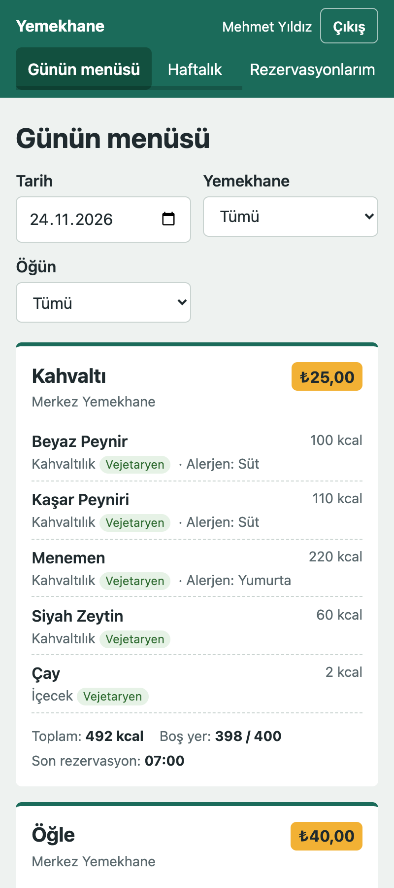<figcaption>Günün menüsü (400 px)</figcaption></figure>
<figure>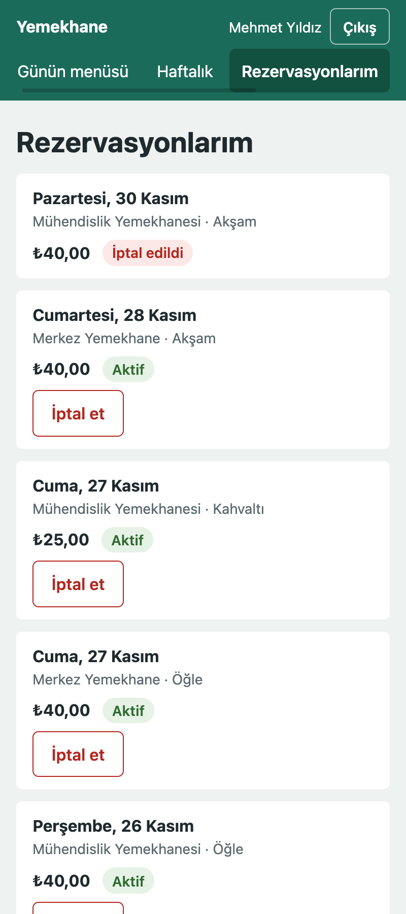<figcaption>Rezervasyonlarım</figcaption></figure>
<figure>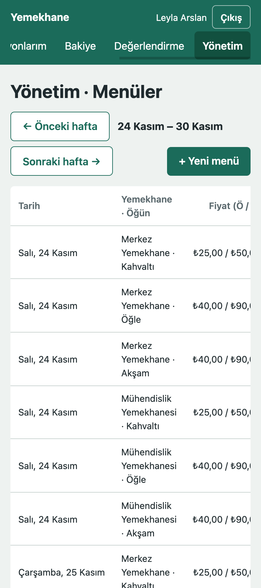<figcaption>Yönetim</figcaption></figure>
</div>

# Aşama 3 · Redis

| Görev | Anahtar | Süre | Silinme |
|---|---|---|---|
| Menü önbelleği | `menu:{yemekhane_id}:{tarih}:{ogun_id}` | gün sonuna kadar (`EXAT` gece yarısı) | yönetici menüyü değiştirince |
| Oturum | `oturum:{token}` (`connect-redis`) | 30 dk, her istekte yenilenir (`rolling`) | çıkışta |

- **Önbelleğe yalnızca menü içeriği** girer (yemekler, fiyatlar). Boş yer her rezervasyonda değişir,
  "rezervasyonum" kişiye özeldir; bunlar her istekte replikadan okunur.
- **Geçersizleştirme:** commit'ten **sonra** `DEL`, ardından yeni içerik **kaynaktan** okunup
  `SET`. Replikadan okunsaydı, replika geride kalırsa eski menü gece yarısına kadar önbellekte
  kalırdı. Okuyan istekler yalnızca boş anahtarı doldurur (`SET NX`), yöneticinin yazdığını ezemez.

<figure>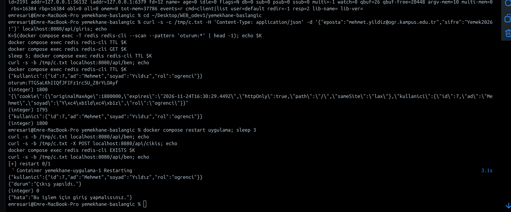<figcaption>Oturum: TTL 1800 → 1795 → istekten sonra 1800; <code>docker compose restart uygulama</code> sonrası oturum düşmedi; çıkışta anahtar silindi (EXISTS 0)</figcaption></figure>

<figure>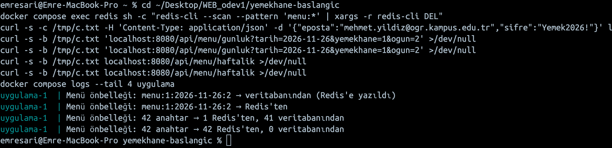<figcaption>Uygulama günlüğü: ilk istek veritabanından, ikincisi Redis'ten (haftalıkta 42 anahtar, tek MGET)</figcaption></figure>

<figure>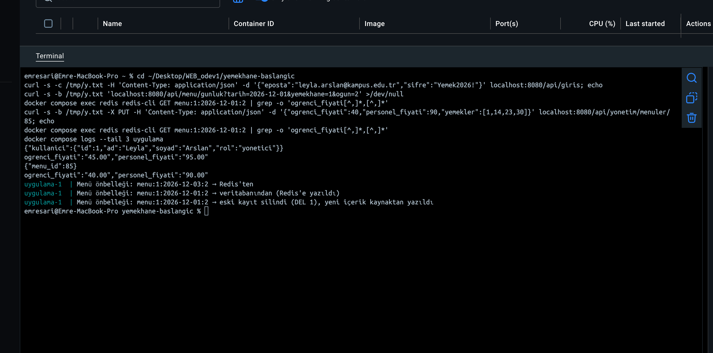<figcaption>Menü güncellenince: önbellekte 45/95 → 40/90, günlükte "eski kayıt silindi (DEL 1), yeni içerik kaynaktan yazıldı"</figcaption></figure>

# Aşama 4 · Değişiklik talebi

Tek migration `db/init/04_degisiklik.sql`, kaynakta çalıştırıldı (önce geçici bir kopyada denendi;
sıfırdan kurulumda 01 ve 02'den sonra kendiliğinden çalışır):

| Değişiklik | Neden |
|---|---|
| `ogunler.yarim_porsiyon` (kahvaltı 0) | "Kahvaltıda yarım yok" kuralı veride |
| `rezervasyonlar.porsiyon ENUM('tam','yarim') DEFAULT 'tam'` | Geçmiş rezervasyonlar hiçbir satır değişmeden tam sayılır |
| Yeni tablo `kullanici_alerjenleri` | Kullanıcı ↔ alerjen (çoka çok) |
| `sp_rezervasyon_yap(kullanici, menu, porsiyon)` | `ROUND(ucret * 0.60, 2)`; "Bu öğünde yarım porsiyon yoktur." |

```
> docker compose exec -T mysql-primary mysql -uroot -p... yemekhane < db/init/04_degisiklik.sql
> (replikada) SHOW CREATE TABLE rezervasyonlar\G
  `porsiyon` enum('tam','yarim') COLLATE utf8mb4_tr_0900_ai_ci NOT NULL DEFAULT 'tam',
> (Redis) redis-cli --scan --pattern 'menu:*' | xargs -r redis-cli DEL     # eski yapıdaki menüler; oturumlar kalır
```

<figure>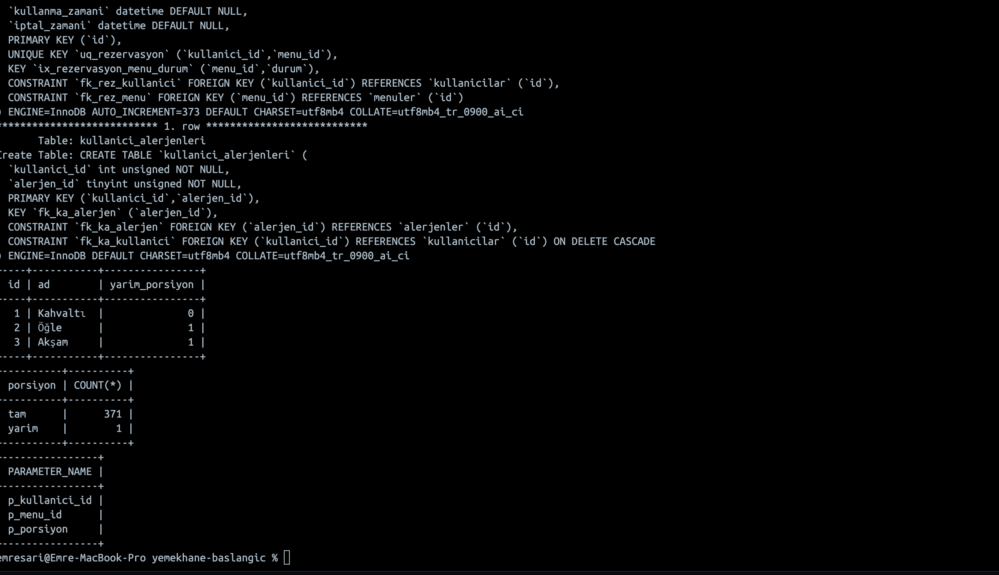<figcaption>Replikada: kullanici_alerjenleri, yarim_porsiyon (kahvaltı 0), 371 eski rezervasyon "tam", yordamın 3 parametresi</figcaption></figure>

<figure>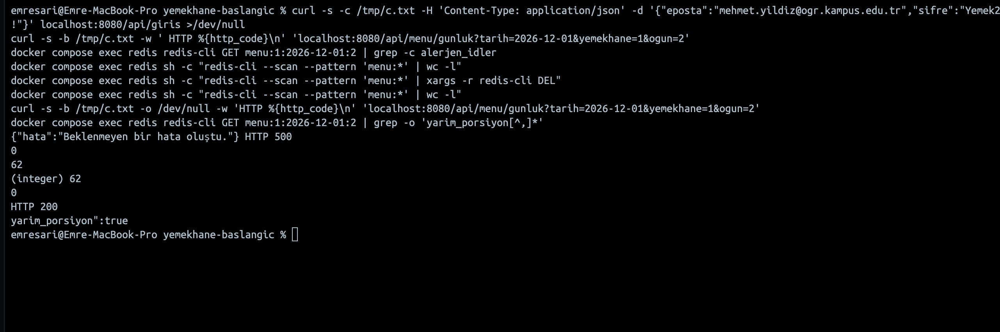<figcaption>Eski yapıdaki kayıtla HTTP 500 (alerjen_idler yok) → 62 menü anahtarı silindi → HTTP 200, yeni kayıtta yarim_porsiyon</figcaption></figure>

**Uygulama:** rezervasyonda `porsiyon` (kural ve ücret yordamda; öğle 40 → yarım 24,00 TL), menüde
`yarim_fiyat` ve her yemekte `uyari` (karar sunucuda), profil uçları. Kullanıcının alerjenleri
oturumda (Redis); kaydedilen liste kaynaktan okunup oturuma yazılır.

<div class="ikili">
<figure>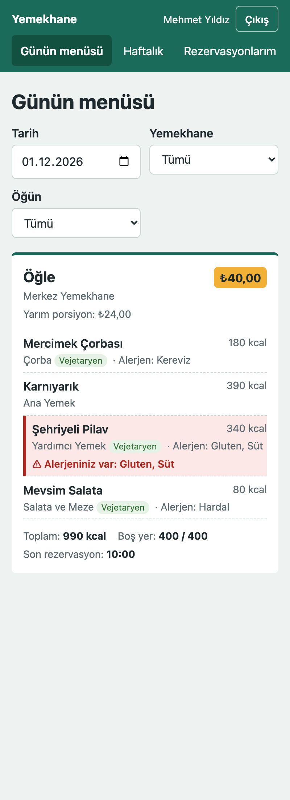<figcaption>Menüde alerjen uyarısı ve yarım porsiyon fiyatı</figcaption></figure>
<figure>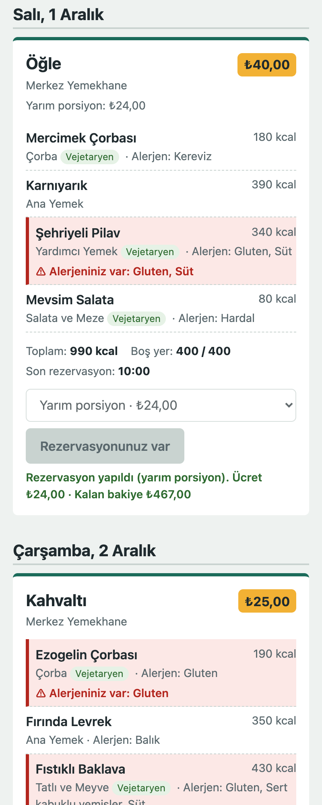<figcaption>Porsiyon seçimi; ücret yordamdan (₺24,00)</figcaption></figure>
</div>

# Karşılaşılan sorunlar ve çözümleri

| Sorun | Neden | Çözüm |
|---|---|---|
| Uygulama container'ı yeniden başlayınca tarayıcıdaki giriş düştü (Aşama 2) | Oturum uygulamanın belleğindeydi (express-session varsayılan deposu) | Aşama 3'te oturum Redis'e taşındı; `docker compose restart uygulama` sonrası oturum düşmüyor |
| Kod düzeltildiği hâlde tarayıcı eski davranışı gösterdi | Tarayıcı eski `.js` dosyasını önbellekten çalıştırdı (Apache `Cache-Control` göndermiyor) | ⌘⇧R ile sert yenileme; yalnızca açık sayfanın dosyalarını yeniler, bu yüzden ilgili sayfada yapılmalı |
| `docker compose ...` → "no configuration file provided: not found" | Komut ev klasöründe çalıştırıldı; compose `docker-compose.yml`'ı bulunulan klasörde arar | Önce `cd ~/Desktop/WEB_odev1/yemekhane-baslangic` |
| Aşama 1'de replika başlatılınca `ERROR 2002` | Container ayakta ama MySQL henüz bağlantı kabul etmiyordu | Birkaç saniye sonra tekrar; sorgu 655,00 döndü |
| Günün menüsü boş geldi | Örnek menüler kurulum gününe göre üretiliyor, tarihler geçmişte kalmıştı | `docker compose down -v` ile veri yeniden üretildi; yeni menüler yönetici panelinden eklenebiliyor |
| Telefonda gezinme çubuğu 4–5 satıra inip ekranın dörtte birini kapladı | Bağlantı sayısı arttıkça satır kırıldı | 600 px altında bağlantılar tek satırda yana kayıyor, aktif sayfa görünür alana getiriliyor |
| Aşama 4'ten sonra menü 500 verdi | Redis'te eski yapıdaki menü kayıtları (`alerjen_idler` yok) | `menu:*` anahtarları temizlendi (bkz. Aşama 4) |

**Kavram: Controller veritabanıyla mı konuşur?** Hayır. Controller isteği denetler, iş kuralını
uygular (şifre doğru mu, hangi fiyat) ve yanıtı hazırlar; veriyi **veri katmanından** ister.
SQL yalnızca `veri/` klasöründedir. Akış: route → Controller → veri katmanı → veritabanı, yanıt
aynı yoldan geri.

**Kavram: her okuma replikadan mı?** Listeleme ve raporlar evet. İstisna: bir yazmanın hemen
ardından gösterilen ya da bir yazma kararına dayanak olan veri (rezervasyon sonrası bakiye,
"menüyü kullandı mı" kontrolü, düzenlenecek menü, önbelleğe yönetici tarafından yazılan menü)
kaynaktan okunur, çünkü replika değişikliği gecikmeyle alır.

<p class="not">Test kullanıcıları (şifre <code>Yemek2026!</code>): öğrenci <code>mehmet.yildiz@ogr.kampus.edu.tr</code>, yönetici <code>leyla.arslan@kampus.edu.tr</code>. Ayrıntılı aşama raporları depoda: <code>rapor/asama-1.md</code> … <code>asama-4.md</code>.</p>
